# Diagramas de secuencia de los casos de uso

- Proyecto: UPBus — Buses UPB en tiempo real (UPB Santa Cruz)
- Fecha: 16/11/2026 · Sprint 1 · Issue: [#3](https://github.com/hugozuniga770/UPBus/issues/3) · Milestone: Sprint 1
- Actualizado: 25/11/2026 · revisión del Product Owner (PO25): abordaje automático, pago iniciado por el estudiante, ajustes de créditos y todo cambio de ruta con aprobación (C-29 a C-32). El 18/11/2026: se agrega CU-18, el modo registro (C-18)
- Estado: **[PROPUESTA]**. Muestran cómo pensamos construir cada caso de uso; los nombres de las funciones se confirman en la [sesión 13–14](sesion-13-14-diseno.md).
- Requisitos: [Sesión 6](sesion-06-requisitos.md) · Cambios: [cambios.md](cambios.md) · Siglas: [glosario.md](glosario.md)

## 0. Cómo leer los diagramas

- **Mismo número, misma funcionalidad:** CU-07 es el caso de uso de HU-07. Sus pasos detallados van en la sesión 7.
- Los participantes son las capas del proyecto, como en el proyecto de reserva de salas:

| Participante | Qué es | Dónde estará |
|---|---|---|
| FE | Las pantallas, en el navegador (celular, computadora o la pantalla del bus) | `frontend/` (React con Tailwind) |
| Vista | Recibe la petición y responde JSON | `views.py` de cada app (Django REST Framework) |
| Servicios | Orquesta: lee lo necesario, pregunta a las reglas y guarda | `servicios.py` |
| Reglas | Decide si se permite y con qué causa se rechaza. No toca la base | `reglas.py` |
| Padrón | Lista de la universidad, de solo lectura | `padron/padron.json` (ejemplo) o `padron/padron.local.json` (la clase, fuera del repositorio), leído solo por `cuentas/padron.py` |
| BD | La base de datos | SQLite, a través de los modelos (`models.py`) |
| Canal | Envía al instante la ubicación, los avisos y los mensajes | Django Channels (WebSocket) |

- Las vistas nunca llaman a las reglas ni guardan en la BD: todo pasa por los servicios.
- Un **rechazo** (`Rechazo` con su causa) no guarda nada y la vista responde con la causa (BUS-RC-01, BUS-RC-03).
- Datos de los ejemplos: los de la sección 0 de los requisitos (Ismael 70004, parada Sevilla de la Ruta Norte, chofer Marco, administrador Hugo).

## 1. CU-01 — Registrarse (HU-01)

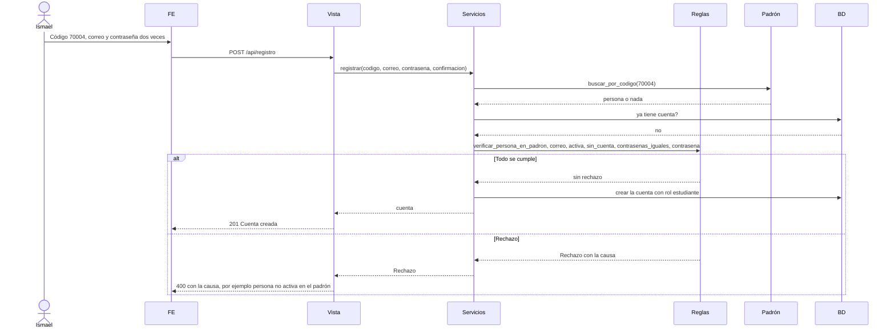

## 2. CU-02 — Iniciar y cerrar sesión (HU-02)

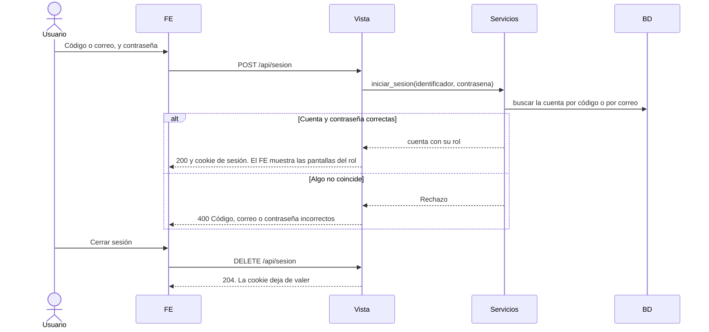

El inicio de sesión no consulta el padrón: solo la BD.

## 3. CU-03 — Gestionar usuarios (HU-03)

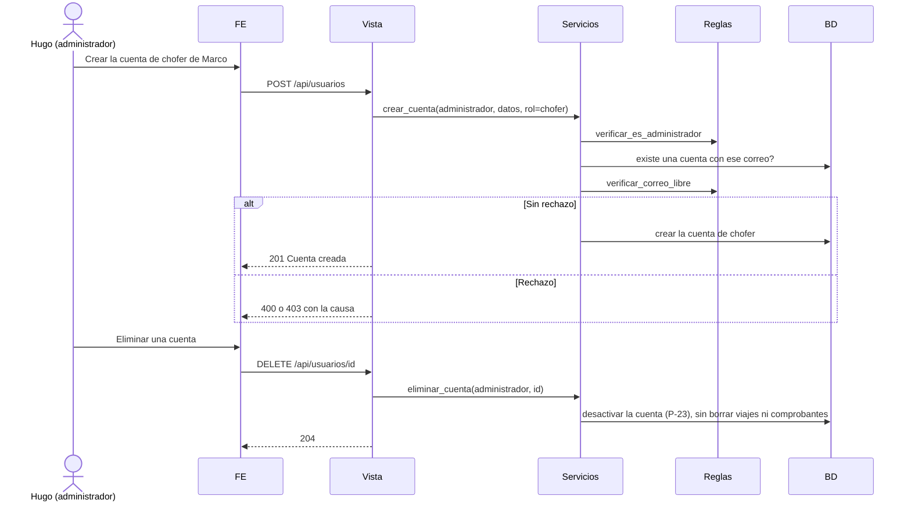

## 4. CU-04 — Ver rutas, paradas y horarios (HU-04)

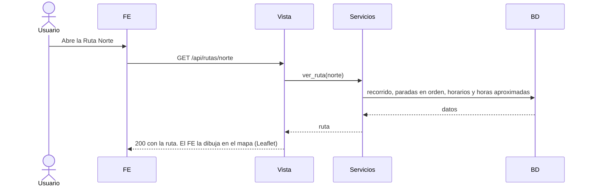

Es una consulta: no cambia nada en la BD (BUS-RC-02).

## 5. CU-05 — Iniciar el viaje y compartir la ubicación (HU-05)

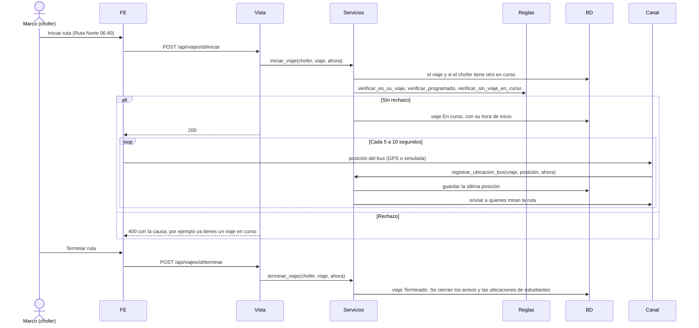

## 6. CU-06 — Ver el bus en vivo y la hora aproximada (HU-06)

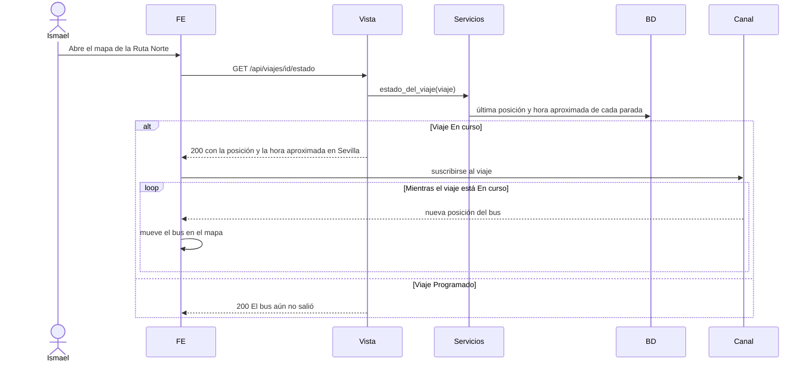

## 7. CU-07 — «Voy a subir» y compartir la ubicación (HU-07)

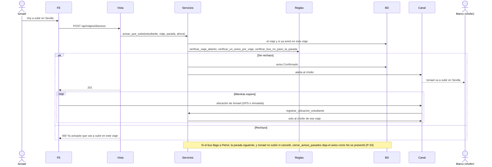

## 8. CU-08 — Proponer una parada (HU-08)

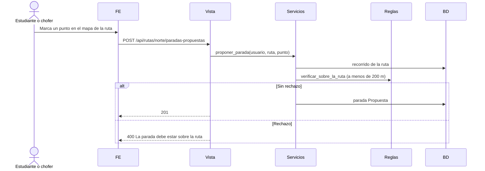

Una parada solo se enciende en un viaje si alguien espera en ella con su ubicación compartida (RF-10).

## 9. CU-09 — Aviso de bus cerca (HU-09)

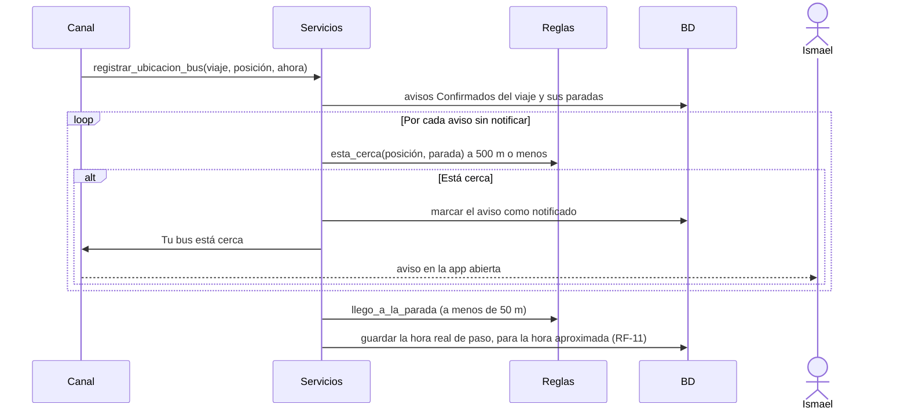

## 10. CU-10 y CU-12 — Registrar quién subió y pagar el viaje (HU-10, HU-12)

Subir y pagar son dos pasos distintos (C-31): registrar que subió no cobra.

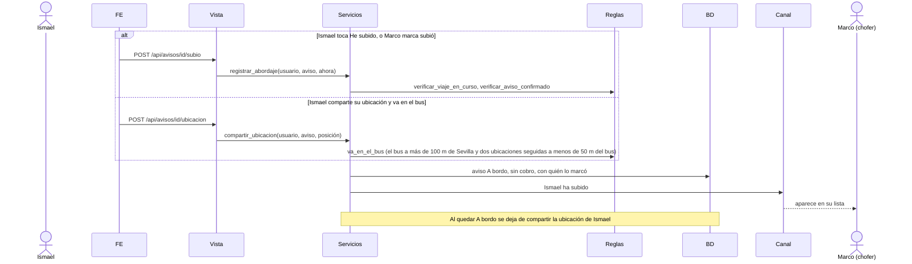

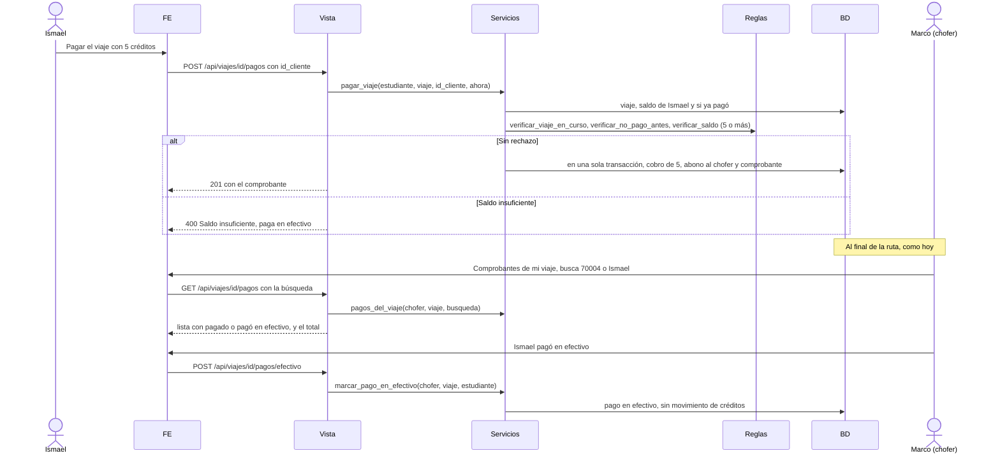

Un reenvío del mismo pago (mismo `id_cliente`) devuelve el mismo comprobante, y un segundo pago del mismo viaje se rechaza por «ya pagaste este viaje»: nunca se cobra dos veces (BUS-RC-03).

## 11. CU-11 — Recargar créditos (HU-11)

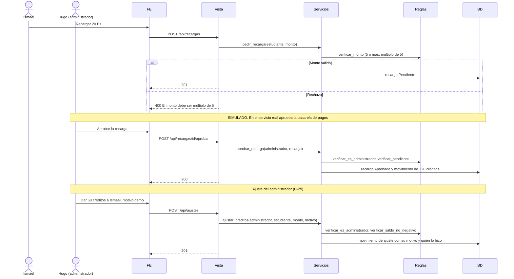

## 12. CU-13 — Retirar el saldo del chofer (HU-13)

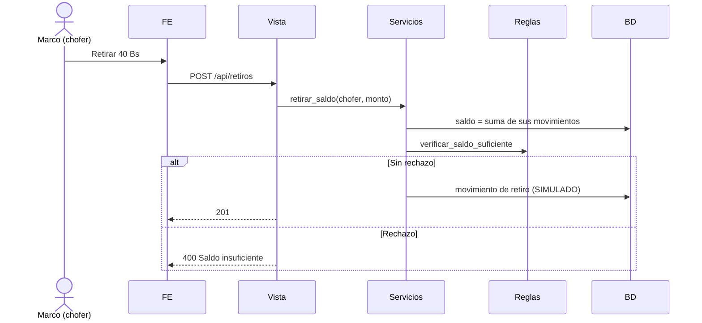

## 13. CU-14 — Chat directo con el chofer (HU-14)

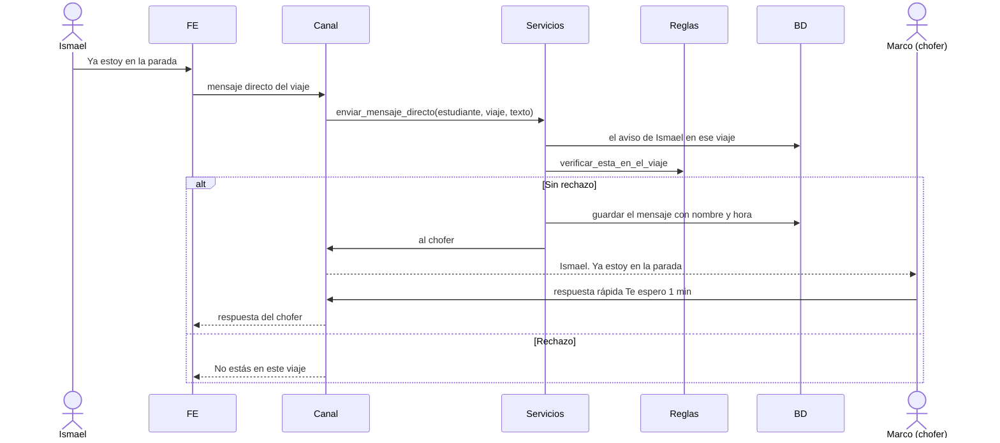

## 14. CU-15 — Chat de la ruta (HU-15)

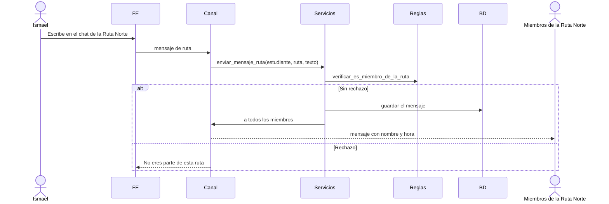

## 15. CU-16 — Modificar una ruta (HU-16)

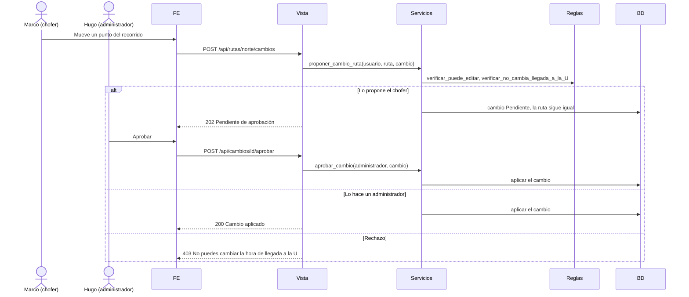

## 16. CU-17 — Confirmados y aviso de mínimo (HU-17)

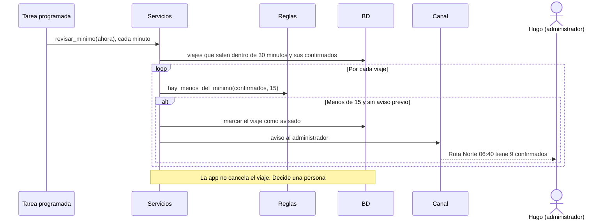

## 17. CU-18 — Modo registro de paradas y horas (HU-18)

Agregado el 18/11/2026 (C-18). A diferencia de los demás, este caso de uso ya está construido en la base del código, así que los nombres son los reales.

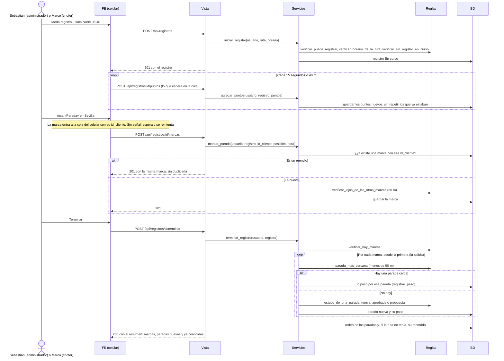

## 18. Simulador de escenarios (T23)

No es un caso de uso del usuario: es la herramienta de la demo y de las pruebas. Lo importante es que **llama a los mismos servicios que la app**, así que un escenario solo funciona si las reglas funcionan. Cómo se usa: [guía del simulador](guia-simulador.md).

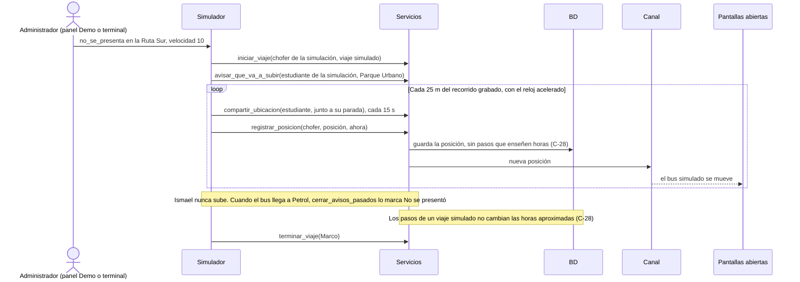

## 19. Participación y asistencia utilizada

- **Hugo Zuñiga (Product Owner):** pidió los diagramas y los aprueba.
- **Asistencia de IA:** se usó Claude (Anthropic) para proponer las secuencias a partir de los requisitos y de la organización por capas del proyecto de referencia, el 18/11/2026 para dibujar la de CU-18 desde el código de la base y el 25/11/2026 para rehacer las de CU-10, CU-11, CU-12 y CU-16 con las decisiones del Product Owner (PO25).
