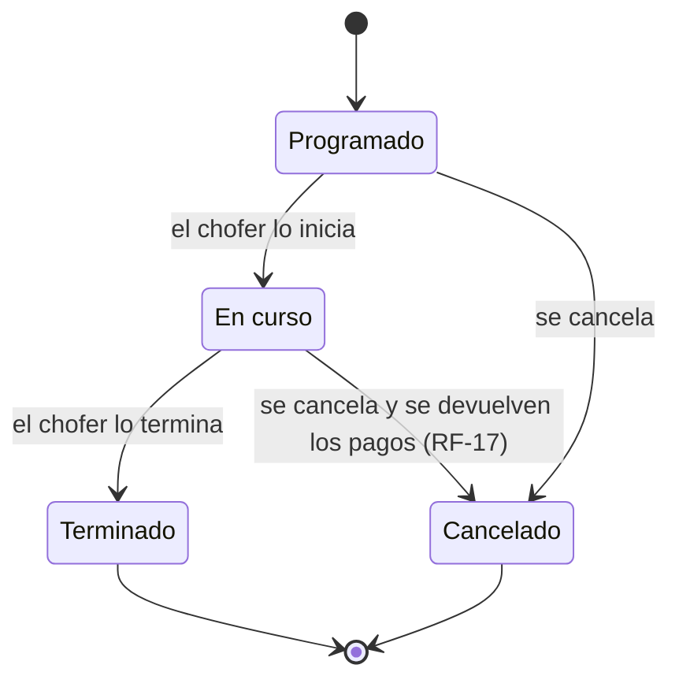
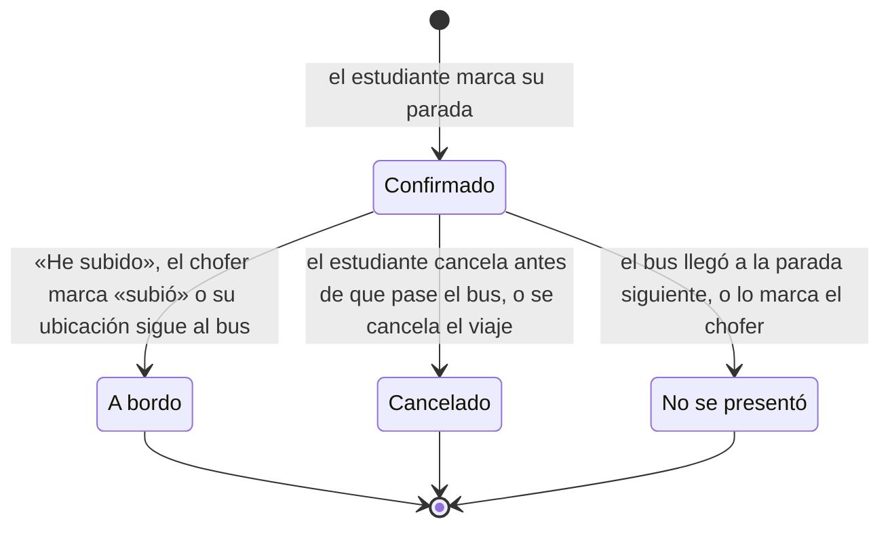
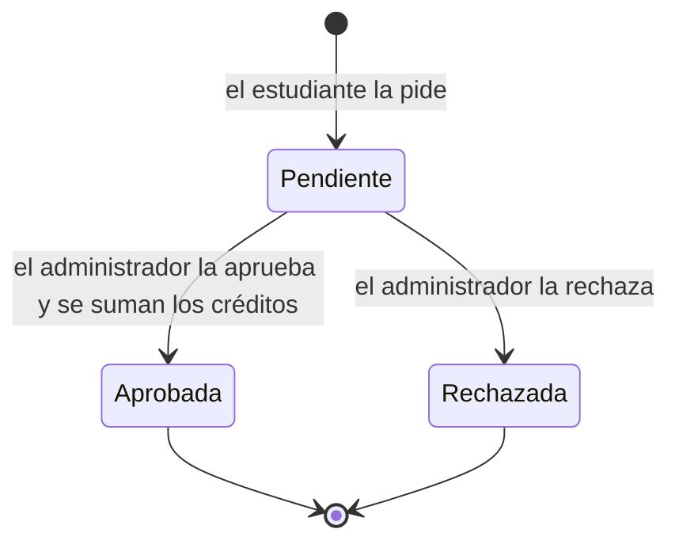
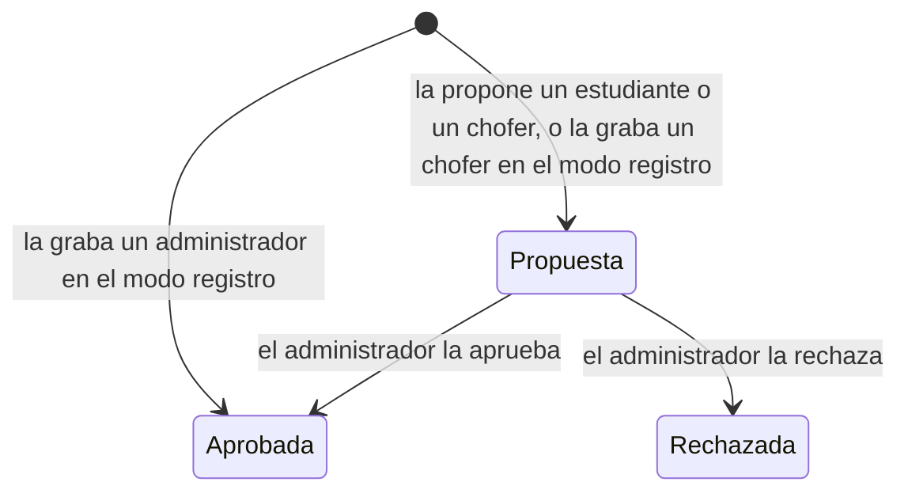
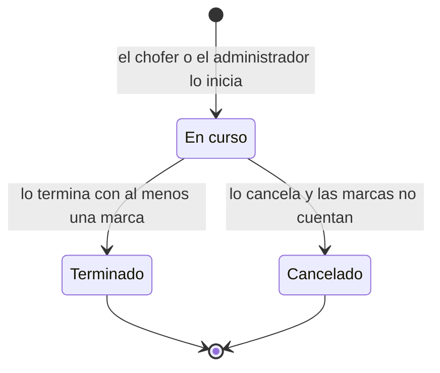
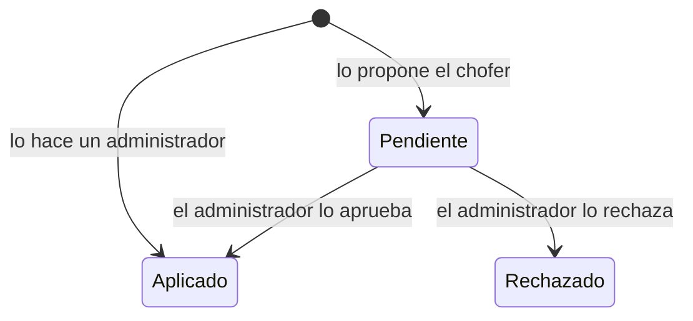
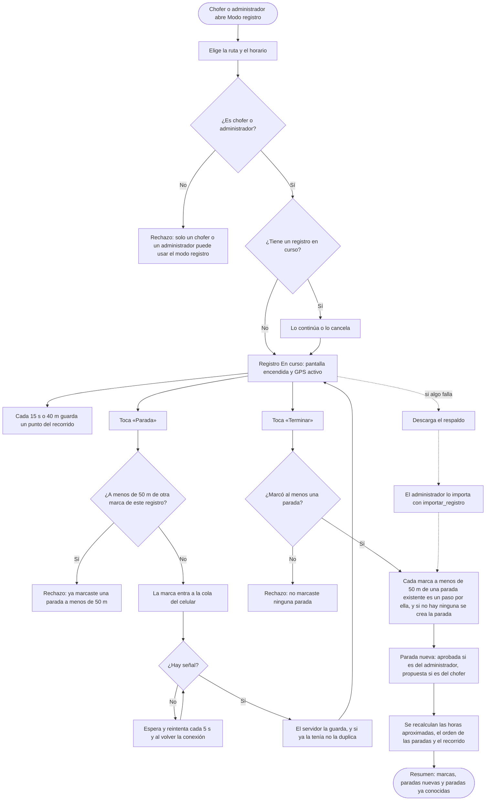

# Sesión 7 — Historias, criterios y casos de uso

- Proyecto: UPBus — Buses UPB en tiempo real (UPB Santa Cruz)
- Integrantes: Hugo Zuñiga (Product Owner), Andrés Laura Vargas (Scrum Master) y Sebastian Cruz
- Docente: Ing. Alejandro Rodríguez (Certificación I) · Aprobado por Hugo Zuñiga, como Product Owner, el 26/11/2026
- Actualizado: 27/11/2026 (mediodía) · historias y criterios en el formato de la guía del docente: cada historia con su frase Como … quiero … para … y su revisión INVEST, y cada criterio con su tipo, escrito como condición verificable; los Dado/Cuando/Entonces quedan como escenario de prueba (C-41). Antes, ese día: HU-09, HU-10 y HU07-CA6 en verde con T16 (C-40): 54 de 75 criterios y 13 historias completas. El 26/11/2026: aprobado por el Product Owner (T02) y HU-07 en verde salvo CA6 (T14). El 25/11/2026: revisión del Product Owner (PO25): HU-07 CA3, HU-10, HU-11, HU-12 y HU-16, con dos criterios nuevos (HU10-CA5 y HU11-CA5), 75 en total (C-28 a C-32). Antes, ese día: HU18-CA2 con las horas medidas desde la salida programada (C-23)
- Fecha: 18/11/2026 · Sprint 1 · Tarea T02 del [plan](sesion-08-09-plan.md) · Issue: [#2](https://github.com/hugozuniga770/UPBus/issues/2) · Milestone: Sprint 1
- Requisitos: [Sesión 6](sesion-06-requisitos.md) · Secuencias: [diagramas-secuencia.md](diagramas-secuencia.md) · Cambios: [cambios.md](cambios.md) · Siglas: [glosario.md](glosario.md)

## 0. Cómo leer este documento

- Una **historia de usuario** (HU) describe una funcionalidad desde la mirada de quien la usa, con la forma **Como** (el rol) … **quiero** (la acción o necesidad) … **para** (el valor o beneficio). Cada historia sale de uno o más requisitos (RF) de la sesión 6 y cumple INVEST (sección 1).
- Los **criterios de aceptación** (CA) son las condiciones claras, medibles y verificables que una historia debe cumplir para considerarse terminada y aceptada por el Product Owner. Cada criterio dice su **tipo**:

| Tipo | Qué dice | Ejemplo en UPBus |
|---|---|---|
| Funcional | Lo que el sistema debe hacer | HU07-CA1: el aviso queda Confirmado y al chofer le llega «Ismael va a subir en Sevilla» |
| Regla de negocio | Una política o regla que debe cumplir | HU09-CA3: el aviso de bus cerca llega una sola vez por viaje |
| Manejo de errores | Qué debe ocurrir si algo sale mal | HU06-CA5: si se corta la señal, se ve la última posición del bus con su hora |
| No funcional | Rendimiento, seguridad, privacidad, usabilidad o fiabilidad | HU07-CA5: la ubicación compartida solo la ven el chofer y los administradores |

- Cómo están escritos: en lenguaje claro; específicos y medibles, con las distancias, los montos y los mensajes exactos; con escenarios positivos y negativos; enfocados en el valor para quien usa la app, y revisados con el Product Owner, que los aprobó el 26/11/2026.
- Cada criterio tiene además un **escenario de prueba** con la forma **Dado** (la situación), **Cuando** (lo que pasa) y **Entonces** (lo que se comprueba).
- **Cada criterio es un test** de pytest con el nombre `test_HUxx_CAy_<qué comprueba>`, en `tests/test_huxx_<tema>.py`. El nombre de cada test ya está escrito abajo: quien toma la historia escribe el test con ese nombre, lo ve fallar y recién entonces escribe el código.
- Algunos criterios tienen además una prueba de interfaz (Vitest) que comprueba lo que ve la persona; se indica junto al test.
- Los datos son los de la [sección 0 de los requisitos](sesion-06-requisitos.md): Ismael (70004, estudiante), Lucía (70005, inactiva), Hugo (70001) y Sebastian (70002), administradores, el chofer Marco, la Ruta Norte de las 06:40 y la parada Sevilla.
- Estado de cada criterio: ✅ el test existe y pasa en la base del código · ⏳ por hacer: el test se escribe con su historia.

## 1. Historias de usuario

| HU | Como… | quiero… | para… | Requisitos | Sprint | Prioridad |
|---|---|---|---|---|---|---|
| HU-01 | persona de la UPB sin cuenta | registrarme con mi código y mi correo del padrón | usar UPBus con mi propia contraseña | RF-01, RF-03 | 1 · en la base | Alta |
| HU-02 | usuario | entrar con mi código o mi correo y cerrar sesión | usar la app con mi rol y dejarla segura | RF-02 | 1 · en la base | Alta |
| HU-03 | administrador | crear y eliminar cuentas de choferes y de personas | que solo usen la app quienes deben | RF-03, RF-04 | 1 · en la base (estaba en el 2) | Alta |
| HU-04 | usuario | ver cada ruta en el mapa con sus paradas, horarios y horas aproximadas | saber dónde y cuándo tomar el bus | RF-05, RF-11 | 1 · en la base (estaba en el 2) | Alta |
| HU-05 | chofer | iniciar y terminar mi viaje | que los estudiantes vean el bus en vivo | RF-06, RF-03 | 2 | Alta |
| HU-06 | estudiante | ver el bus en vivo y a qué hora pasará por mi parada | no perderlo ni esperar de más | RF-07, RF-11 | 2 | Alta |
| HU-07 | estudiante | avisar «Voy a subir» en mi parada y compartir mi ubicación | que el chofer sepa que lo espero | RF-08, RF-09, RF-03 | 3 | Alta |
| HU-08 | estudiante o chofer | proponer una parada sobre el recorrido | subir donde de verdad espero | RF-10 | 3 | Media |
| HU-09 | estudiante | recibir un aviso cuando el bus está cerca de mi parada | salir a tiempo | RF-13, RF-12 | 3 | Media |
| HU-10 | estudiante o chofer | registrar que subí, o que subió, o que la app lo detecte sola si comparto mi ubicación | que quede el abordaje y el chofer sepa quién va en el bus | RF-14 | 3 | Alta |
| HU-11 | estudiante o administrador | recargar créditos (y, como administrador, darlos y quitarlos) | pagar el viaje desde la app y corregir errores | RF-15 | 3 y 4 | Media |
| HU-12 | estudiante o chofer | pagar el viaje con créditos y tener un comprobante (y, como chofer, revisar los comprobantes de mi viaje) | no manejar efectivo y saber quién pagó | RF-16, RF-17 | 4 | Media |
| HU-13 | chofer | retirar mi saldo | cobrar lo que pagaron con créditos | RF-18 | 4 | Baja |
| HU-14 | estudiante o chofer | escribirnos directo durante el viaje | avisar sin llamar ni usar WhatsApp | RF-19 | 4 | Media |
| HU-15 | estudiante o chofer | usar el chat de mi ruta | reemplazar el grupo de WhatsApp | RF-20 | 4 | Media |
| HU-16 | chofer o administrador | proponer un cambio a una ruta (y, como administrador, aprobarlo) | mantenerla al día con la aprobación de la UPB | RF-21 | 4 | Baja |
| HU-17 | chofer o administrador | ver cuántos confirmaron y recibir el aviso de mínimo | saber si la ruta tiene estudiantes suficientes | RF-22, RF-03 | 4 | Baja |
| HU-18 | chofer o administrador | marcar cada parada mientras hago el recorrido | que la app aprenda las paradas y sus horas sin cargarlas a mano | RF-23, RF-11 | 1 · en la base | Alta |

HU-18 es nueva: sale de la decisión del Product Owner del 18/11/2026 (C-18). RF-12, la sugerencia de saltar una parada, va con HU-09 porque sale del mismo cálculo: la posición del bus comparada con las paradas (C-21). HU10-CA5 y HU11-CA5 salen de la revisión del Product Owner del 25/11/2026 (C-29, C-30).

### Las historias cumplen INVEST

Una buena historia es **I**ndependiente, **N**egociable, **V**aliosa, **E**stimable, pequeña (**S**mall) y **T**esteable. Cuando una historia necesita otra antes, la tabla lo dice: es el orden de los sprints, no una historia que no se pueda hacer sola.

| HU | Independiente | Negociable | Valiosa | Estimable | Pequeña: entra en un sprint | Testeable |
|---|---|---|---|---|---|---|
| HU-01 | Sí | Sí | Sin cuenta no hay app; la UPB pide que sea solo para la universidad (ENT-07) | T08 · 8 h-p, con HU-02 | Sí · sprint 1 | Sí: 4 criterios, 4 en verde |
| HU-02 | Sí | Sí | Cada rol ve cosas distintas: sin sesión no hay permisos | T08 · 8 h-p, con HU-01 | Sí · sprint 1 | Sí: 4 criterios, 4 en verde |
| HU-03 | Sí | Sí: pasó del sprint 2 al 1 | Los choferes no están en el padrón: alguien crea sus cuentas | T09 · 4 h-p | Sí · sprint 1 | Sí: 4 criterios, 4 en verde |
| HU-04 | Sí | Sí: pasó del sprint 2 al 1 | Hoy solo hay un PDF con puntos de partida | T10 · 8 h-p | Sí · sprint 1 | Sí: 2 criterios, 2 en verde |
| HU-05 | Depende de HU-03 (cuentas de chofer) | Sí | Sin viaje iniciado no hay bus en vivo | T11 · 10 h-p, con HU-06 | Sí · sprint 2 | Sí: 4 criterios, 4 en verde |
| HU-06 | Depende de HU-05 | Sí | Lo que más pidieron el chofer, la estudiante y la UPB (ENT-01, ENT-02, ENT-07) | T11 · 10 h-p, con HU-05 | Sí · sprint 2 | Sí: 5 criterios, 5 en verde |
| HU-07 | Depende de HU-05 | Sí: CA3 cambió el 25/11 (C-30) | El chofer no sabe quién sube y la UPB recibe reclamos (ENT-07) | T14 · 8 h-p | Sí · sprint 3 | Sí: 7 criterios, 7 en verde |
| HU-08 | Depende de HU-04 | Sí | Completa las paradas que falten (ENT-01, ENT-02) | T15 · 8 h-p | Sí · sprint 3 | Sí: 4 criterios, 4 en verde |
| HU-09 | Depende de HU-06 y HU-07 | Sí: sumó la sugerencia de RF-12 (C-21) | Ayuda a salir a tiempo; la hora aproximada de HU-06 cubre lo principal | T16 · 6 h-p, con HU-10 | Sí · sprint 3 | Sí: 5 criterios, 5 en verde |
| HU-10 | Depende de HU-07 | Sí: abordaje automático el 25/11 (C-30) | Saber quién va en el bus y cerrar los avisos | T16 · 6 h-p, con HU-09 | Sí · sprint 3 | Sí: 5 criterios, 5 en verde |
| HU-11 | Sí | Sí: ajustes del administrador el 25/11 (C-29) | Pagar sin efectivo; el docente pidió créditos en vez de QR | T17 · 10 h-p, con HU-12 | Sí, si T17 va en dos PR · sprints 3 y 4 | Sí: 5 criterios, por hacer |
| HU-12 | Depende de HU-05 y HU-11 | Sí: subir ya no cobra (C-31) | Reemplaza el efectivo y deja comprobante | T17 · 10 h-p, con HU-11 | Sí · sprint 4 | Sí: 6 criterios, por hacer |
| HU-13 | Depende de HU-12 | Sí | El chofer cobra lo que pagaron con créditos | T18 · 3 h-p | Sí · sprint 4 | Sí: 2 criterios, por hacer |
| HU-14 | Depende de HU-07 (solo confirmados) | Sí: respuestas rápidas provisionales | Avisar sin llamar ni usar WhatsApp (ENT-02) | T19 · 8 h-p, con HU-15 | Sí · sprint 4 | Sí: 3 criterios, 3 en verde |
| HU-15 | Sí | Sí | Reemplaza el grupo de WhatsApp de cada ruta (ENT-02) | T19 · 8 h-p, con HU-14 | Sí · sprint 4 | Sí: 2 criterios, 2 en verde |
| HU-16 | Depende de HU-04 | Sí: todo cambio queda pendiente (C-32) | Rutas al día con la aprobación de la UPB (ENT-01, ENT-03, ENT-07) | T20 · 6 h-p, con HU-17 | Sí · sprint 4 | Sí: 4 criterios, por hacer |
| HU-17 | Depende de HU-07 | Sí | Saber si la ruta llega a los 15 estudiantes (guía, ENT-07) | T20 · 6 h-p, con HU-16 | Sí · sprint 4 | Sí: 4 criterios, por hacer |
| HU-18 | Depende de HU-04 | Sí: nueva, decisión del Product Owner (C-18) | Paradas y horas reales sin cargarlas a mano | T25 · 8 h-p | Sí · sprint 1 | Sí: 5 criterios, 5 en verde |

## 2. Criterios de aceptación

Cada historia empieza con su frase (Como … quiero … para …). Sigue la tabla de sus criterios, cada uno con su tipo y su estado, y después el escenario de prueba de cada criterio, con los datos de la [sección 0 de los requisitos](sesion-06-requisitos.md) y el nombre de su test.

### HU-01 — Registrarme con el padrón

**Como** persona de la UPB sin cuenta, **quiero** registrarme con mi código y mi correo del padrón, **para** usar UPBus con mi propia contraseña.

| # | Criterio de aceptación | Tipo | Estado |
|---|---|---|---|
| CA1 | Una persona activa en el padrón se registra con su código, su correo y una contraseña escrita dos veces: su cuenta queda con rol estudiante, puede entrar con ella y el padrón no cambia. | Funcional | ✅ |
| CA2 | Si la persona está inactiva en el padrón, el registro se rechaza con «persona no activa en el padrón» y no se crea ninguna cuenta. | Regla de negocio | ✅ |
| CA3 | Si las dos contraseñas no coinciden, el registro se rechaza con «las contraseñas no coinciden», no se crea ninguna cuenta y la pantalla muestra esa causa. | Manejo de errores | ✅ |
| CA4 | La cuenta toma el rol que la persona tiene en el padrón: quien figura como administrador queda como administrador y puede usar también las funciones de estudiante. | Regla de negocio | ✅ |

Escenarios de prueba:

**CA1** · `test_HU01_CA1_registra_cuenta_con_codigo_y_correo_del_padron`
- Dado: Ismael (70004, ismael@upb.example) está activo en el padrón y no tiene cuenta.
- Cuando: se registra con su código, su correo y una contraseña válida escrita dos veces.
- Entonces: se crea su cuenta con rol estudiante, puede entrar con ella y el padrón no cambia.

**CA2** · `test_HU01_CA2_rechaza_registro_de_persona_inactiva`
- Dado: Lucía (70005) está inactiva en el padrón.
- Cuando: intenta registrarse con su código y su correo.
- Entonces: se rechaza por «persona no activa en el padrón» y no se crea ninguna cuenta.

**CA3** · `test_HU01_CA3_rechaza_si_las_contrasenas_no_coinciden` · Vitest: «HU01-CA3 muestra la causa cuando las contraseñas no coinciden»
- Dado: Ismael está activo y sin cuenta.
- Cuando: escribe dos contraseñas distintas.
- Entonces: se rechaza por «las contraseñas no coinciden», no se crea ninguna cuenta y la pantalla muestra esa causa.

**CA4** · `test_HU01_CA4_la_cuenta_toma_el_rol_de_administrador_del_padron`
- Dado: Hugo (70001) figura como administrador en el padrón y no tiene cuenta.
- Cuando: se registra.
- Entonces: su cuenta queda con rol administrador y puede usar también las funciones de estudiante.

### HU-02 — Entrar y salir con código o correo

**Como** usuario, **quiero** entrar con mi código o mi correo y cerrar sesión, **para** usar la app con mi rol y dejarla segura.

| # | Criterio de aceptación | Tipo | Estado |
|---|---|---|---|
| CA1 | El usuario entra con su código y su contraseña, e inicia sesión con su rol. | Funcional | ✅ |
| CA2 | El usuario entra con su correo y su contraseña, e inicia sesión con su rol. | Funcional | ✅ |
| CA3 | Si el código, el correo o la contraseña no coinciden, la respuesta es siempre «Código, correo o contraseña incorrectos», sin decir qué dato falló (seguridad). | No funcional | ✅ |
| CA4 | Al cerrar sesión, cualquier pedido siguiente se rechaza con «debes iniciar sesión» hasta que vuelva a entrar. | Funcional | ✅ |

Escenarios de prueba:

**CA1** · `test_HU02_CA1_entra_con_su_codigo`
- Dado: Ismael tiene cuenta.
- Cuando: entra con 70004 y su contraseña.
- Entonces: inicia sesión como estudiante.

**CA2** · `test_HU02_CA2_entra_con_su_correo`
- Dado: Ismael tiene cuenta.
- Cuando: entra con ismael@upb.example y la misma contraseña.
- Entonces: inicia sesión como estudiante.

**CA3** · `test_HU02_CA3_un_solo_mensaje_si_algo_no_coincide` · Vitest: «HU02-CA3 muestra el único mensaje que da el servidor, sin decir qué dato falló»
- Dado: Ismael tiene cuenta.
- Cuando: entra con una contraseña incorrecta y, después, con un código que no existe.
- Entonces: las dos veces recibe «Código, correo o contraseña incorrectos», sin decir qué dato falló.

**CA4** · `test_HU02_CA4_al_cerrar_sesion_vuelve_a_pedir_inicio`
- Dado: Ismael inició sesión.
- Cuando: cierra sesión y vuelve a pedir la lista de rutas.
- Entonces: se rechaza por «debes iniciar sesión».

### HU-03 — Gestionar usuarios

**Como** administrador, **quiero** crear y eliminar cuentas de choferes y de personas, **para** que solo usen la app quienes deben.

| # | Criterio de aceptación | Tipo | Estado |
|---|---|---|---|
| CA1 | El administrador crea la cuenta de un chofer con su correo y una contraseña: el chofer entra con ese correo, tiene rol chofer y no puede actuar como estudiante. | Funcional | ✅ |
| CA2 | Un correo tiene una sola cuenta: si ya existe, la nueva se rechaza con «ya existe una cuenta con ese correo». | Regla de negocio | ✅ |
| CA3 | Solo el administrador crea cuentas: si lo intenta un estudiante, se rechaza con «solo el administrador puede hacer esto» y no se crea nada. | Regla de negocio | ✅ |
| CA4 | Eliminar una cuenta la desactiva, no la borra: la persona ya no puede entrar y recibe «Código, correo o contraseña incorrectos». | Regla de negocio | ✅ |

Escenarios de prueba:

**CA1** · `test_HU03_CA1_el_administrador_crea_la_cuenta_de_un_chofer`
- Dado: Hugo inició sesión como administrador.
- Cuando: crea la cuenta de chofer de Marco (marco.chofer@upbus.example) con una contraseña.
- Entonces: Marco puede entrar con ese correo, tiene rol chofer y no puede actuar como estudiante.

**CA2** · `test_HU03_CA2_rechaza_un_correo_que_ya_tiene_cuenta`
- Dado: Ismael ya tiene cuenta con ismael@upb.example.
- Cuando: Hugo intenta crear otra cuenta con ese correo.
- Entonces: se rechaza por «ya existe una cuenta con ese correo».

**CA3** · `test_HU03_CA3_un_estudiante_no_puede_crear_cuentas`
- Dado: Ismael inició sesión como estudiante.
- Cuando: intenta crear la cuenta de chofer de Marco.
- Entonces: se rechaza por «solo el administrador puede hacer esto» y no se crea nada.

**CA4** · `test_HU03_CA4_eliminar_desactiva_la_cuenta`
- Dado: Marco tiene cuenta de chofer.
- Cuando: Hugo la elimina.
- Entonces: la cuenta queda desactivada, no borrada, y Marco recibe «Código, correo o contraseña incorrectos» al intentar entrar (P-23).

### HU-04 — Ver rutas, paradas y horarios

**Como** usuario, **quiero** ver cada ruta en el mapa con sus paradas, horarios y horas aproximadas, **para** saber dónde y cuándo tomar el bus.

| # | Criterio de aceptación | Tipo | Estado |
|---|---|---|---|
| CA1 | Al abrir una ruta con un horario se ven su recorrido, sus paradas en orden y sus horarios; mirarla no cambia nada en la base de datos. | Funcional | ✅ |
| CA2 | El estudiante ve solo las paradas aprobadas; el chofer ve también las propuestas, marcadas como tales. | Regla de negocio | ✅ |

Escenarios de prueba:

**CA1** · `test_HU04_CA1_ve_la_ruta_con_recorrido_paradas_y_horarios`
- Dado: la Ruta Norte tiene recorrido y las paradas La Fontana, Sevilla, Petrol, Campos y Campus UPB.
- Cuando: Ismael la abre con el horario de ingreso de las 06:40.
- Entonces: ve el recorrido, las cinco paradas en orden y los horarios de ingreso 06:40, 11:00, 13:00 y 15:30, y nada cambia en la BD.

**CA2** · `test_HU04_CA2_el_estudiante_ve_solo_las_paradas_aprobadas`
- Dado: la Ruta Norte tiene Sevilla aprobada y «Av. Banzer y 4to anillo» propuesta.
- Cuando: Ismael y Marco abren la ruta.
- Entonces: Ismael ve solo Sevilla; Marco ve las dos, con la propuesta marcada como tal.

### HU-05 — Iniciar y terminar mi viaje

**Como** chofer, **quiero** iniciar y terminar mi viaje, **para** que los estudiantes vean el bus en vivo.

| # | Criterio de aceptación | Tipo | Estado |
|---|---|---|---|
| CA1 | El chofer inicia su viaje programado y el viaje pasa a En curso con la hora de inicio. | Funcional | ✅ |
| CA2 | Un chofer no puede tener dos viajes en curso: el segundo se rechaza con «ya tienes un viaje en curso» y sigue Programado. | Regla de negocio | ✅ |
| CA3 | El chofer termina su viaje: pasa a Terminado con su hora de fin y se cierran los avisos y las ubicaciones compartidas de ese viaje. | Funcional | ✅ |
| CA4 | Un chofer no puede iniciar un viaje asignado a otro: se rechaza con «este viaje no es tuyo». | Regla de negocio | ✅ |

Escenarios de prueba:

**CA1** · `test_HU05_CA1_el_chofer_inicia_su_viaje`
- Dado: Marco tiene asignado el viaje Ruta Norte 06:40 del lunes 16/11, Programado, y son las 06:38.
- Cuando: lo inicia.
- Entonces: el viaje pasa a En curso con la hora de inicio 06:38.

**CA2** · `test_HU05_CA2_rechaza_un_segundo_viaje_en_curso`
- Dado: Marco tiene En curso el viaje de las 06:40.
- Cuando: intenta iniciar otro viaje suyo.
- Entonces: se rechaza por «ya tienes un viaje en curso» y el segundo sigue Programado.

**CA3** · `test_HU05_CA3_el_chofer_termina_su_viaje`
- Dado: el viaje de las 06:40 está En curso.
- Cuando: Marco lo termina a las 07:38.
- Entonces: pasa a Terminado con su hora de fin, y se cierran los avisos y las ubicaciones compartidas de ese viaje.

**CA4** · `test_HU05_CA4_rechaza_iniciar_un_viaje_ajeno`
- Dado: el viaje Ruta Sur 06:40 está asignado a otro chofer.
- Cuando: Marco intenta iniciarlo.
- Entonces: se rechaza por «este viaje no es tuyo».

### HU-06 — Ver el bus en vivo y la hora aproximada en mi parada

**Como** estudiante, **quiero** ver el bus en vivo y a qué hora pasará por mi parada, **para** no perderlo ni esperar de más.

| # | Criterio de aceptación | Tipo | Estado |
|---|---|---|---|
| CA1 | Cada posición del bus se guarda como la última del viaje y llega en tiempo real (WebSocket) a quienes miran la ruta. | Funcional | ✅ |
| CA2 | Si el viaje no está en curso, la posición se rechaza con «el viaje no está en curso» y no se guarda. | Manejo de errores | ✅ |
| CA3 | Cuando el bus pasa a menos de 50 m de una parada se registra un paso con los minutos desde la salida y se recalcula la hora aproximada de esa parada. | Regla de negocio | ✅ |
| CA4 | Si el bus pasa a más de 50 m de la parada (por ejemplo, a 80 m), no cuenta como llegada y no se registra ningún paso. | Regla de negocio | ✅ |
| CA5 | Si se corta la señal del bus, el estudiante ve su última posición con la hora en que llegó. | Manejo de errores | ✅ |

Escenarios de prueba:

**CA1** · `test_HU06_CA1_la_posicion_del_bus_llega_a_quienes_miran_la_ruta`
- Dado: el viaje de las 06:40 está En curso e Ismael mira la Ruta Norte.
- Cuando: llega una posición del bus.
- Entonces: queda guardada como la última del viaje e Ismael la recibe por el canal en tiempo real (WebSocket).

**CA2** · `test_HU06_CA2_rechaza_posiciones_de_un_viaje_que_no_esta_en_curso`
- Dado: el viaje de las 06:40 está Terminado.
- Cuando: llega una posición para ese viaje.
- Entonces: se rechaza por «el viaje no está en curso» y no se guarda.

**CA3** · `test_HU06_CA3_pasar_a_menos_de_50_m_registra_un_paso`
- Dado: el viaje salió a las 06:40 y Sevilla está en la ruta.
- Cuando: el bus pasa a 30 m de Sevilla a las 06:58.
- Entonces: se registra un paso por Sevilla a los 18 minutos y la hora aproximada se recalcula (RF-11). Usa `registrar_paso`, el mismo servicio del modo registro.

**CA4** · `test_HU06_CA4_pasar_a_80_m_no_cuenta_como_llegada`
- Dado: el mismo viaje.
- Cuando: el bus pasa a 80 m de Sevilla.
- Entonces: no se registra ningún paso.

**CA5** · `test_HU06_CA5_sin_senal_se_ve_la_ultima_posicion_con_su_hora`
- Dado: la última posición del bus llegó a las 06:52 y después dejó de llegar señal.
- Cuando: Ismael abre el viaje a las 06:55.
- Entonces: ve la posición de las 06:52 con su hora.

### HU-07 — Avisar «Voy a subir» y compartir mi ubicación

**Como** estudiante, **quiero** avisar «Voy a subir» en mi parada y compartir mi ubicación, **para** que el chofer sepa que lo espero.

| # | Criterio de aceptación | Tipo | Estado |
|---|---|---|---|
| CA1 | El estudiante avisa «Voy a subir» en una parada por la que el bus todavía no pasó: el aviso queda Confirmado y al chofer le llega «[nombre] va a subir en [parada]». | Funcional | ✅ |
| CA2 | Cada estudiante avisa una sola vez por viaje: el segundo aviso se rechaza con «ya avisaste que vas a subir en este viaje». | Regla de negocio | ✅ |
| CA3 | Si el bus deja la parada y llega a la siguiente sin que el estudiante suba ni cancele, el aviso queda «no se presentó»; mientras el bus está en la parada, sigue Confirmado. | Regla de negocio | ✅ |
| CA4 | El estudiante puede cancelar su aviso antes de que el bus llegue a su parada: queda Cancelado y el chofer deja de verlo. | Funcional | ✅ |
| CA5 | La ubicación compartida solo la ven el chofer y los administradores; ningún otro estudiante la ve (privacidad). | No funcional | ✅ |
| CA6 | Cuando el estudiante sube, su ubicación deja de compartirse en ese momento (privacidad). | No funcional | ✅ |
| CA7 | Un administrador también puede avisar «Voy a subir», con el mismo resultado que un estudiante. | Regla de negocio | ✅ |

Escenarios de prueba:

**CA1** · `test_HU07_CA1_avisa_que_va_a_subir`
- Dado: el viaje de las 06:40 no pasó por Sevilla.
- Cuando: Ismael marca «Voy a subir» en Sevilla.
- Entonces: el aviso queda Confirmado y a Marco le llega «Ismael va a subir en Sevilla».

**CA2** · `test_HU07_CA2_rechaza_un_segundo_aviso_en_el_mismo_viaje`
- Dado: Ismael ya está Confirmado en el viaje de las 06:40.
- Cuando: lo marca de nuevo.
- Entonces: se rechaza por «ya avisaste que vas a subir en este viaje».

**CA3** · `test_HU07_CA3_si_el_bus_pasa_y_no_subio_queda_no_se_presento`
- Dado: Ismael está Confirmado en Sevilla.
- Cuando: el bus pasa Sevilla y llega a Petrol sin que Ismael suba ni cancele.
- Entonces: el aviso queda «no se presentó». Mientras el bus está en Sevilla, el aviso sigue Confirmado **[PROVISIONAL]** (P-33).

**CA4** · `test_HU07_CA4_puede_cancelar_antes_de_que_pase_el_bus`
- Dado: Ismael está Confirmado y el bus no llegó a Sevilla.
- Cuando: cancela su aviso.
- Entonces: el aviso queda Cancelado y Marco deja de verlo.

**CA5** · `test_HU07_CA5_el_chofer_ve_la_ubicacion_compartida`
- Dado: Ismael está Confirmado en el viaje de las 06:40.
- Cuando: comparte su ubicación.
- Entonces: Marco y los administradores la ven; ningún otro estudiante la ve.

**CA6** · `test_HU07_CA6_deja_de_compartir_al_subir`
- Dado: Ismael comparte su ubicación.
- Cuando: Marco lo marca «subió».
- Entonces: la ubicación de Ismael deja de compartirse en ese momento.

**CA7** · `test_HU07_CA7_un_administrador_tambien_puede_avisar`
- Dado: Hugo es administrador.
- Cuando: marca «Voy a subir» en Sevilla para el viaje de las 06:40.
- Entonces: su aviso queda Confirmado, igual que el de un estudiante.

### HU-08 — Proponer una parada

**Como** estudiante o chofer, **quiero** proponer una parada sobre el recorrido, **para** subir donde de verdad espero.

| # | Criterio de aceptación | Tipo | Estado |
|---|---|---|---|
| CA1 | El estudiante propone una parada sobre el recorrido y queda registrada como propuesta. | Funcional | ✅ |
| CA2 | Una parada a más de 200 m del recorrido se rechaza con «la parada debe estar sobre la ruta». | Regla de negocio | ✅ |
| CA3 | Una parada en la que nadie marcó «Voy a subir» no está activa y el chofer no recibe avisos de ella. | Regla de negocio | ✅ |
| CA4 | El administrador aprueba una parada propuesta y desde entonces todos la ven en la ruta. | Funcional | ✅ |

Escenarios de prueba:

**CA1** · `test_HU08_CA1_propone_una_parada_sobre_la_ruta`
- Dado: la Ruta Norte tiene recorrido.
- Cuando: Ismael propone la parada «Av. Banzer y 4to anillo» sobre el recorrido.
- Entonces: queda registrada como propuesta.

**CA2** · `test_HU08_CA2_rechaza_una_parada_lejos_del_recorrido`
- Dado: la misma ruta.
- Cuando: Ismael propone una parada a más de 200 m del recorrido.
- Entonces: se rechaza por «la parada debe estar sobre la ruta» (P-07).

**CA3** · `test_HU08_CA3_una_parada_sin_nadie_no_esta_activa`
- Dado: en el viaje de las 06:40 nadie marcó «Voy a subir» en Sevilla.
- Cuando: el bus se acerca a Sevilla.
- Entonces: la parada no está activa y Marco no recibe avisos de ella.

**CA4** · `test_HU08_CA4_el_administrador_aprueba_una_parada_propuesta`
- Dado: «Av. Banzer y 4to anillo» está propuesta.
- Cuando: Hugo la aprueba.
- Entonces: queda aprobada y todos la ven en la ruta **[PROVISIONAL]** (P-05, P-28).

### HU-09 — Recibir el aviso de bus cerca

**Como** estudiante, **quiero** recibir un aviso cuando el bus está cerca de mi parada, **para** salir a tiempo.

| # | Criterio de aceptación | Tipo | Estado |
|---|---|---|---|
| CA1 | Cuando el bus queda a 500 m o menos de la parada de un estudiante confirmado, le llega «Tu bus está cerca». | Funcional | ✅ |
| CA2 | Con el bus a más de 500 m no hay aviso. | Regla de negocio | ✅ |
| CA3 | El aviso de bus cerca llega una sola vez por viaje. | Regla de negocio | ✅ |
| CA4 | Si el bus va atrasado y en la parada no hay confirmados ni estudiantes a menos de 500 m, al chofer le aparece «Nadie espera en [parada]: puedes seguir»; la app no decide por él. | Funcional | ✅ |
| CA5 | Si un estudiante confirmado está a menos de 500 m de la parada, no se sugiere seguir. | Regla de negocio | ✅ |

Escenarios de prueba:

**CA1** · `test_HU09_CA1_avisa_cuando_el_bus_esta_a_500_m_o_menos`
- Dado: Ismael está Confirmado en Sevilla.
- Cuando: el bus queda a 480 m de Sevilla.
- Entonces: Ismael recibe «Tu bus está cerca».

**CA2** · `test_HU09_CA2_no_avisa_a_mas_de_500_m`
- Dado: lo mismo.
- Cuando: el bus está a 520 m.
- Entonces: no hay aviso.

**CA3** · `test_HU09_CA3_avisa_una_sola_vez_por_viaje`
- Dado: Ismael ya recibió el aviso a 480 m.
- Cuando: el bus llega a 300 m.
- Entonces: no recibe un segundo aviso.

**CA4** · `test_HU09_CA4_sugiere_seguir_si_nadie_espera`
- Dado: el bus va 6 minutos atrasado y en Sevilla no hay confirmados ni estudiantes a menos de 500 m.
- Cuando: el bus se acerca a Sevilla.
- Entonces: a Marco le aparece «Nadie espera en Sevilla: puedes seguir». La app no decide por él (RF-12).

**CA5** · `test_HU09_CA5_no_sugiere_seguir_si_alguien_viene`
- Dado: el bus va atrasado y hay un estudiante confirmado a 300 m de Sevilla.
- Cuando: el bus se acerca a Sevilla.
- Entonces: no se muestra la sugerencia.

### HU-10 — Registrar quién subió

**Como** estudiante o chofer, **quiero** registrar que subí, o que subió, o que la app lo detecte sola si comparto mi ubicación, **para** que quede el abordaje y el chofer sepa quién va en el bus.

| # | Criterio de aceptación | Tipo | Estado |
|---|---|---|---|
| CA1 | El estudiante confirmado toca «He subido»: queda A bordo, subir no le cobra créditos y al chofer le aparece «[nombre]: ha subido». | Funcional | ✅ |
| CA2 | El chofer marca «subió» a un estudiante confirmado y queda A bordo, sin cobro. | Funcional | ✅ |
| CA3 | Si el viaje ya terminó, «He subido» se rechaza con «el viaje ya terminó». | Manejo de errores | ✅ |
| CA4 | El chofer puede marcar «no se presentó» a un estudiante confirmado. | Funcional | ✅ |
| CA5 | Si el estudiante comparte su ubicación y, con el bus a más de 100 m de la parada, llegan dos ubicaciones seguidas a menos de 50 m del bus, queda A bordo sin que nadie toque nada y deja de compartir su ubicación; con una sola ubicación cerca, sigue Confirmado. | Regla de negocio | ✅ |

Escenarios de prueba:

**CA1** · `test_HU10_CA1_el_estudiante_registra_que_subio`
- Dado: Ismael está Confirmado, tiene 10 créditos y el viaje está En curso.
- Cuando: toca «He subido».
- Entonces: queda A bordo, sigue con 10 créditos porque subir no cobra (C-31) y a Marco le aparece «Ismael: ha subido».

**CA2** · `test_HU10_CA2_el_chofer_registra_que_subio`
- Dado: Ismael está Confirmado y el viaje está En curso.
- Cuando: Marco lo marca «subió».
- Entonces: Ismael queda A bordo, sin cobro.

**CA3** · `test_HU10_CA3_rechaza_subir_a_un_viaje_terminado`
- Dado: el viaje de las 06:40 está Terminado.
- Cuando: Ismael toca «He subido».
- Entonces: se rechaza por «el viaje ya terminó».

**CA4** · `test_HU10_CA4_el_chofer_marca_no_se_presento`
- Dado: Ismael está Confirmado y el viaje está En curso.
- Cuando: Marco lo marca «no se presentó».
- Entonces: el aviso queda «no se presentó».

**CA5** · `test_HU10_CA5_queda_a_bordo_si_avanza_con_el_bus`
- Dado: Ismael está Confirmado en Sevilla, comparte su ubicación y el bus ya pasó por Sevilla.
- Cuando: el bus está a más de 100 m de Sevilla y llegan dos ubicaciones seguidas de Ismael a menos de 50 m del bus.
- Entonces: Ismael queda A bordo sin que nadie toque nada y deja de compartir su ubicación. Con una sola ubicación cerca del bus, sigue Confirmado **[PROVISIONAL]** (P-33).

### HU-11 — Recargar créditos

**Como** estudiante o administrador, **quiero** recargar créditos (y, como administrador, darlos y quitarlos), **para** pagar el viaje desde la app y corregir errores.

| # | Criterio de aceptación | Tipo | Estado |
|---|---|---|---|
| CA1 | Una recarga pedida queda Pendiente y no cambia el saldo; cuando el administrador la aprueba, el saldo sube en el monto (20 Bs, 20 créditos) y queda el movimiento. | Funcional | ⏳ |
| CA2 | Un monto que no es múltiplo de 5 se rechaza con «el monto debe ser múltiplo de 5» y no se registra nada. | Regla de negocio | ⏳ |
| CA3 | La recarga mínima de 5 Bs se acepta y queda Pendiente. | Regla de negocio | ⏳ |
| CA4 | Solo el administrador aprueba recargas: si lo intenta el estudiante, se rechaza con «solo el administrador puede hacer esto» y la recarga sigue Pendiente. | Regla de negocio | ⏳ |
| CA5 | El administrador da y quita créditos con un motivo, y cada ajuste queda como movimiento con su motivo y quién lo hizo; quitar más que el saldo se rechaza con «saldo insuficiente» y nada cambia. | Funcional | ⏳ |

Escenarios de prueba:

**CA1** · `test_HU11_CA1_la_recarga_aprobada_suma_creditos`
- Dado: Ismael tiene 0 créditos.
- Cuando: pide recargar 20 Bs y Hugo la aprueba.
- Entonces: mientras la recarga está Pendiente su saldo no cambia; al aprobarse sube a 20 créditos y queda el movimiento.

**CA2** · `test_HU11_CA2_rechaza_un_monto_que_no_es_multiplo_de_5`
- Dado: Ismael inició sesión.
- Cuando: pide recargar 12 Bs.
- Entonces: se rechaza por «el monto debe ser múltiplo de 5» y no se registra nada.

**CA3** · `test_HU11_CA3_acepta_el_minimo_de_5`
- Dado: Ismael inició sesión.
- Cuando: pide recargar 5 Bs.
- Entonces: la recarga queda Pendiente.

**CA4** · `test_HU11_CA4_solo_el_administrador_aprueba`
- Dado: la recarga de 20 Bs de Ismael está Pendiente.
- Cuando: Ismael intenta aprobarla.
- Entonces: se rechaza por «solo el administrador puede hacer esto» y la recarga sigue Pendiente.

**CA5** · `test_HU11_CA5_el_administrador_da_y_quita_creditos`
- Dado: Ismael tiene 0 créditos.
- Cuando: Hugo le da 50 créditos con el motivo «demo» y después le quita 10 con el motivo «recarga de más».
- Entonces: Ismael queda con 40 y quedan los dos ajustes como movimientos, con su motivo y quién los hizo. Si Hugo intenta quitarle 50, se rechaza por «saldo insuficiente» y nada cambia (C-29).

### HU-12 — Pagar el viaje y ver el comprobante

**Como** estudiante o chofer, **quiero** pagar el viaje con créditos y tener un comprobante (y, como chofer, revisar los comprobantes de mi viaje), **para** no manejar efectivo y saber quién pagó.

| # | Criterio de aceptación | Tipo | Estado |
|---|---|---|---|
| CA1 | El estudiante paga un viaje en curso con 5 créditos: se le descuentan, se suman al saldo del chofer y queda un comprobante con su ID, el código, el correo y el nombre del estudiante, la ruta, el viaje, la fecha, la hora y el monto. | Funcional | ⏳ |
| CA2 | Sin saldo suficiente, el pago se rechaza con «saldo insuficiente: paga en efectivo», no se cobra nada y el saldo no cambia. | Manejo de errores | ⏳ |
| CA3 | Un viaje se paga una sola vez: un reenvío del mismo pago (mismo `id_cliente`) no cobra de nuevo ni duplica el comprobante, y pagar otra vez ese viaje se rechaza con «ya pagaste este viaje». | Regla de negocio | ⏳ |
| CA4 | Al final de la ruta, el chofer ve los comprobantes de su viaje con el total y encuentra cada uno por el código o el nombre del estudiante, marcado «pagado». | Funcional | ⏳ |
| CA5 | El chofer marca que un estudiante pagó en efectivo: aparece en la lista como «pagó en efectivo», sin movimiento de créditos. | Funcional | ⏳ |
| CA6 | Si el viaje se cancela, el estudiante recupera sus créditos, se descuentan del saldo del chofer y quedan los dos movimientos: el pago y la devolución. | Regla de negocio | ⏳ |

Escenarios de prueba:

**CA1** · `test_HU12_CA1_paga_el_viaje_con_5_creditos`
- Dado: Ismael tiene 10 créditos, Marco tiene saldo 0 y el viaje de las 06:40 está En curso.
- Cuando: Ismael paga el viaje desde la app.
- Entonces: Ismael queda con 5, Marco con 5 y existe un comprobante con su ID, el código, el correo y el nombre de Ismael, la ruta, el viaje, la fecha, la hora y el monto.

**CA2** · `test_HU12_CA2_sin_saldo_paga_en_efectivo`
- Dado: Ismael tiene 3 créditos y el viaje está En curso.
- Cuando: intenta pagar el viaje.
- Entonces: se rechaza por «saldo insuficiente: paga en efectivo», no se cobra nada y su saldo sigue en 3.

**CA3** · `test_HU12_CA3_un_mismo_pago_se_cobra_una_vez`
- Dado: Ismael tiene 10 créditos y el viaje está En curso.
- Cuando: el celular reenvía el mismo pago (mismo `id_cliente`) y después Ismael intenta pagar otra vez el mismo viaje.
- Entonces: se cobra una sola vez, existe un solo comprobante y el segundo intento se rechaza por «ya pagaste este viaje».

**CA4** · `test_HU12_CA4_el_chofer_ve_los_pagos_de_su_viaje`
- Dado: en el viaje de las 06:40 pagaron Ismael y Hugo.
- Cuando: al final de la ruta, Marco abre la lista de comprobantes de su viaje y busca «70004» y después «Ismael».
- Entonces: ve los dos comprobantes con un total de 10, y las dos búsquedas devuelven el de Ismael con «pagado».

**CA5** · `test_HU12_CA5_el_chofer_marca_que_pago_en_efectivo`
- Dado: Ismael viajó en el viaje de las 06:40 y no pagó con créditos.
- Cuando: al final de la ruta, Marco lo busca por su código y marca que pagó en efectivo.
- Entonces: Ismael aparece en la lista como «pagó en efectivo», sin movimiento de créditos (P-13).

**CA6** · `test_HU12_CA6_devuelve_los_creditos_si_se_cancela_el_viaje`
- Dado: Ismael pagó 5 créditos en el viaje de las 06:40.
- Cuando: el viaje se cancela.
- Entonces: Ismael recupera 5, se descuentan del saldo de Marco y quedan los dos movimientos: el pago y la devolución (RF-17).

### HU-13 — Retirar mi saldo

**Como** chofer, **quiero** retirar mi saldo, **para** cobrar lo que pagaron con créditos.

| # | Criterio de aceptación | Tipo | Estado |
|---|---|---|---|
| CA1 | El chofer retira su saldo: queda en 0 y existe el movimiento de retiro. | Funcional | ⏳ |
| CA2 | Un retiro mayor al saldo se rechaza con «saldo insuficiente» y nada cambia. | Manejo de errores | ⏳ |

Escenarios de prueba:

**CA1** · `test_HU13_CA1_retira_todo_su_saldo`
- Dado: Marco tiene 40 Bs de saldo.
- Cuando: retira 40.
- Entonces: queda en 0 y existe el movimiento de retiro.

**CA2** · `test_HU13_CA2_rechaza_un_retiro_mayor_al_saldo`
- Dado: Marco tiene 40 Bs.
- Cuando: intenta retirar 50.
- Entonces: se rechaza por «saldo insuficiente» y nada cambia.

### HU-14 — Chatear directo con el chofer

**Como** estudiante o chofer, **quiero** escribirnos directo durante el viaje, **para** avisar sin llamar ni usar WhatsApp.

| # | Criterio de aceptación | Tipo | Estado |
|---|---|---|---|
| CA1 | El estudiante confirmado le escribe al chofer y el chofer recibe el mensaje con el nombre del estudiante y la hora. | Funcional | ✅ |
| CA2 | Solo los confirmados del viaje escriben al chofer: si no lo está, se rechaza con «no estás en este viaje». | Regla de negocio | ✅ |
| CA3 | El chofer responde con una respuesta rápida (por ejemplo, «Ya llego») sin tener que escribir ni soltar el volante (usabilidad). | No funcional | ✅ |

Escenarios de prueba:

**CA1** · `test_HU14_CA1_el_confirmado_le_escribe_al_chofer`
- Dado: Ismael está Confirmado en el viaje de Marco.
- Cuando: le escribe «Ya estoy en la parada».
- Entonces: Marco lo recibe con el nombre de Ismael y la hora.

**CA2** · `test_HU14_CA2_rechaza_escribir_sin_estar_en_el_viaje`
- Dado: Ismael no está Confirmado en el viaje.
- Cuando: intenta escribirle al chofer.
- Entonces: se rechaza por «no estás en este viaje».

**CA3** · `test_HU14_CA3_el_chofer_responde_con_una_respuesta_rapida`
- Dado: Ismael le escribió a Marco.
- Cuando: Marco toca una respuesta rápida, por ejemplo «Ya llego».
- Entonces: Ismael la recibe sin que Marco tenga que escribir. Las respuestas rápidas son **[PROVISIONAL]**.

### HU-15 — Usar el chat de la ruta

**Como** estudiante o chofer, **quiero** usar el chat de mi ruta, **para** reemplazar el grupo de WhatsApp.

| # | Criterio de aceptación | Tipo | Estado |
|---|---|---|---|
| CA1 | Un miembro escribe en el chat de su ruta y los demás miembros lo ven con su nombre y la hora. | Funcional | ✅ |
| CA2 | Solo los miembros escriben en el chat de una ruta: si no la eligió, se rechaza con «no eres parte de esta ruta». | Regla de negocio | ✅ |

Escenarios de prueba:

**CA1** · `test_HU15_CA1_el_miembro_escribe_en_el_chat_de_su_ruta`
- Dado: Ismael eligió la Ruta Norte.
- Cuando: escribe en su chat.
- Entonces: lo ven los demás miembros, con su nombre y la hora.

**CA2** · `test_HU15_CA2_rechaza_escribir_en_una_ruta_ajena`
- Dado: Ismael no eligió la Ruta Sur.
- Cuando: intenta escribir en su chat.
- Entonces: se rechaza por «no eres parte de esta ruta».

### HU-16 — Modificar una ruta

**Como** chofer o administrador, **quiero** proponer un cambio a una ruta (y, como administrador, aprobarlo), **para** mantenerla al día con la aprobación de la UPB.

| # | Criterio de aceptación | Tipo | Estado |
|---|---|---|---|
| CA1 | Todo cambio del chofer al recorrido queda Pendiente y la ruta sigue igual hasta que se apruebe. | Regla de negocio | ⏳ |
| CA2 | El administrador aprueba un cambio pendiente: se aplica y todos ven la ruta nueva. | Funcional | ⏳ |
| CA3 | El chofer no puede cambiar la hora de llegada a la U: se rechaza con «no puedes cambiar la hora de llegada a la U». | Regla de negocio | ⏳ |
| CA4 | Un estudiante no puede modificar rutas: se rechaza con «solo un chofer o un administrador puede modificar una ruta» y nada cambia. | Regla de negocio | ⏳ |

Escenarios de prueba:

**CA1** · `test_HU16_CA1_todo_cambio_queda_pendiente`
- Dado: Marco es el chofer de la Ruta Norte.
- Cuando: mueve un punto del recorrido 80 m.
- Entonces: el cambio queda Pendiente y la ruta sigue igual (C-32).

**CA2** · `test_HU16_CA2_el_administrador_aprueba_el_cambio`
- Dado: el cambio de 80 m de Marco está Pendiente.
- Cuando: Hugo lo aprueba.
- Entonces: el cambio se aplica y todos ven la ruta nueva.

**CA3** · `test_HU16_CA3_el_chofer_no_cambia_la_hora_de_llegada`
- Dado: Marco es el chofer de la Ruta Norte.
- Cuando: Marco intenta cambiar la hora de llegada a la U.
- Entonces: se rechaza por «no puedes cambiar la hora de llegada a la U».

**CA4** · `test_HU16_CA4_un_estudiante_no_modifica_rutas`
- Dado: Ismael es estudiante.
- Cuando: intenta mover un punto del recorrido.
- Entonces: se rechaza por «solo un chofer o un administrador puede modificar una ruta» **[PROPUESTA]** y nada cambia.

### HU-17 — Ver los confirmados y recibir el aviso de mínimo

**Como** chofer o administrador, **quiero** ver cuántos confirmaron y recibir el aviso de mínimo, **para** saber si la ruta tiene estudiantes suficientes.

| # | Criterio de aceptación | Tipo | Estado |
|---|---|---|---|
| CA1 | 30 minutos antes de la salida, si el viaje tiene menos de 15 confirmados, el administrador recibe el aviso de mínimo y el viaje sigue Programado. | Funcional | ⏳ |
| CA2 | Con 15 o más confirmados no hay aviso de mínimo. | Regla de negocio | ⏳ |
| CA3 | El chofer ve cuántos confirmaron en su viaje y en qué parada sube cada uno. | Funcional | ⏳ |
| CA4 | Un chofer no puede ver los confirmados de un viaje ajeno: se rechaza con «este viaje no es tuyo». | Regla de negocio | ⏳ |

Escenarios de prueba:

**CA1** · `test_HU17_CA1_avisa_si_faltan_estudiantes_30_minutos_antes`
- Dado: son las 06:10 y el viaje de las 06:40 tiene 9 confirmados.
- Cuando: corre la revisión del mínimo.
- Entonces: Hugo recibe el aviso y el viaje sigue Programado.

**CA2** · `test_HU17_CA2_no_avisa_con_15_confirmados`
- Dado: a las 06:10 el viaje tiene 15 confirmados.
- Cuando: corre la revisión.
- Entonces: no hay aviso.

**CA3** · `test_HU17_CA3_el_chofer_ve_cuantos_confirmaron`
- Dado: el viaje de las 06:40 tiene 9 confirmados.
- Cuando: Marco abre su viaje.
- Entonces: ve 9 confirmados y en qué parada sube cada uno.

**CA4** · `test_HU17_CA4_rechaza_ver_los_confirmados_de_un_viaje_ajeno`
- Dado: el viaje Ruta Sur 06:40 tiene otro chofer.
- Cuando: Marco pide sus confirmados.
- Entonces: se rechaza por «este viaje no es tuyo».

### HU-18 — Registrar paradas y horas en un viaje real

**Como** chofer o administrador, **quiero** marcar cada parada mientras hago el recorrido, **para** que la app aprenda las paradas y sus horas sin cargarlas a mano.

| # | Criterio de aceptación | Tipo | Estado |
|---|---|---|---|
| CA1 | El primer registro de una ruta crea sus paradas aprobadas, en el orden marcado y con la hora aproximada de cada una. | Funcional | ✅ |
| CA2 | Un nuevo registro que marca a menos de 50 m de una parada que ya existe no la duplica: ajusta su hora aproximada al promedio de los minutos desde la salida programada. | Regla de negocio | ✅ |
| CA3 | Un estudiante no puede usar el modo registro: se rechaza con «solo un chofer o un administrador puede usar el modo registro». | Regla de negocio | ✅ |
| CA4 | Una marca a menos de 50 m de otra del mismo registro se rechaza con «ya marcaste una parada a menos de 50 m» y no se guarda. | Manejo de errores | ✅ |
| CA5 | Una marca que se reenvía por falta de señal (mismo identificador) se guarda una sola vez (fiabilidad). | No funcional | ✅ |

Escenarios de prueba:

**CA1** · `test_HU18_CA1_el_primer_registro_crea_las_paradas_y_sus_horas`
- Dado: la Ruta Norte no tiene paradas y Sebastian es administrador.
- Cuando: el viernes 20/11 graba el viaje de las 06:40, marca La Fontana a las 06:40, Sevilla a las 06:58 y Campus UPB a las 07:35, y termina.
- Entonces: quedan tres paradas aprobadas, en ese orden, y la hora aproximada de Sevilla es 06:58.

**CA2** · `test_HU18_CA2_un_segundo_registro_ajusta_la_hora_sin_duplicar_la_parada`
- Dado: el registro de CA1.
- Cuando: el lunes 23/11 el bus sale a las 06:41 y Sebastian marca a 30 m de Sevilla a las 07:02, 22 minutos después de la salida programada de las 06:40.
- Entonces: sigue habiendo una sola parada Sevilla y su hora aproximada pasa a 07:00, el promedio de 18 y 22 minutos.

**CA3** · `test_HU18_CA3_un_estudiante_no_puede_usar_el_modo_registro`
- Dado: Ismael es estudiante.
- Cuando: intenta iniciar un registro.
- Entonces: se rechaza por «solo un chofer o un administrador puede usar el modo registro».

**CA4** · `test_HU18_CA4_rechaza_una_marca_a_menos_de_50_m_de_otra`
- Dado: Sebastian marcó Sevilla en su registro en curso.
- Cuando: marca otra parada a 20 m de Sevilla.
- Entonces: se rechaza por «ya marcaste una parada a menos de 50 m» y no se guarda.

**CA5** · `test_HU18_CA5_una_marca_reenviada_se_guarda_una_sola_vez` · Vitest: «HU18-CA5 una marca agregada dos veces queda una sola vez»
- Dado: Sebastian está grabando sin señal estable.
- Cuando: la marca de Sevilla se envía dos veces con el mismo identificador.
- Entonces: se guarda una sola vez.

## 3. Casos de uso

Cada caso de uso tiene el número de su historia. El flujo principal está en su diagrama de secuencia; los rechazos son los de sus criterios.

| CU | Historia | Actor principal | Disparador | Resultado | Diagrama |
|---|---|---|---|---|---|
| CU-01 Registrarse | HU-01 | Persona del padrón | Escribe código, correo y contraseña dos veces | Cuenta creada con el rol del padrón; queda dentro | [Secuencias](diagramas-secuencia.md), sección 1 |
| CU-02 Iniciar y cerrar sesión | HU-02 | Cualquier usuario | Escribe código o correo y contraseña | Sesión abierta con su rol, o cerrada | Sección 2 |
| CU-03 Gestionar usuarios | HU-03 | Administrador | Crea o elimina una cuenta | Cuenta creada, o desactivada | Sección 3 |
| CU-04 Ver rutas | HU-04 | Cualquier usuario | Abre una ruta y elige un horario | Mapa con recorrido, paradas y horas | Sección 4 |
| CU-05 Iniciar y terminar el viaje | HU-05 | Chofer | Toca «Iniciar ruta» | Viaje En curso y ubicación enviándose | Sección 5 |
| CU-06 Ver el bus en vivo | HU-06 | Estudiante | Abre su ruta | Bus en el mapa y hora en su parada | Sección 6 |
| CU-07 «Voy a subir» | HU-07 | Estudiante | Marca su parada en un viaje | Aviso Confirmado y alerta al chofer | Sección 7 |
| CU-08 Proponer una parada | HU-08 | Estudiante o chofer | Toca un punto del recorrido | Parada propuesta | Sección 8 |
| CU-09 Aviso de bus cerca | HU-09 | Sistema (posición del bus) | Llega una posición nueva | Aviso al estudiante o sugerencia al chofer | Sección 9 |
| CU-10 Registrar quién subió | HU-10 | Estudiante, chofer o sistema (ubicación del estudiante) | «He subido», «subió», o la ubicación del estudiante sigue al bus | Abordaje registrado, sin cobro | Sección 10 |
| CU-11 Recargar créditos | HU-11 | Estudiante o administrador | Pide una recarga, o el administrador hace un ajuste | Recarga Pendiente y luego Aprobada, o ajuste registrado | Sección 11 |
| CU-12 Pagar el viaje | HU-12 | Estudiante; el chofer revisa | Toca «Pagar» en su viaje | Pago y comprobante; al final, el chofer revisa la lista y marca el efectivo | Sección 10 |
| CU-13 Retirar el saldo | HU-13 | Chofer | Pide un retiro | Saldo descontado y movimiento | Sección 12 |
| CU-14 Chat directo | HU-14 | Estudiante o chofer | Escribe un mensaje | Mensaje entregado al otro | Sección 13 |
| CU-15 Chat de la ruta | HU-15 | Estudiante o chofer | Escribe en el chat de su ruta | Mensaje visible para la ruta | Sección 14 |
| CU-16 Modificar una ruta | HU-16 | Chofer o administrador | Edita el recorrido o una parada | Cambio Pendiente si es del chofer, hasta que el administrador lo aprueba | Sección 15 |
| CU-17 Confirmados y aviso de mínimo | HU-17 | Tarea programada | Faltan 30 minutos para la salida | Aviso al administrador si hay menos de 15 | Sección 16 |
| CU-18 Modo registro | HU-18 | Chofer o administrador | Inicia un registro en un viaje real | Paradas, recorrido y horas aprendidas | Sección 17 y la actividad de la sección 5 de este documento |

## 4. Estados

### Viaje (RF-06)

### Aviso «Voy a subir» (RF-09, RF-14)

### Recarga de créditos (RF-15)

### Parada (RF-10, RF-23)

### Registro del modo registro (RF-23)

### Cambio de ruta (RF-21)

## 5. Actividad del modo registro (HU-18)

## 6. Trazabilidad requisito → historia → criterio

La relación criterio → test → archivo de código está en `docs/trazabilidad.md`, que llega con la base del código.

| Requisito | Historia | Criterios |
|---|---|---|
| RF-01 Registro con el padrón | HU-01 | CA1 a CA4 |
| RF-02 Inicio y cierre de sesión | HU-02 | CA1 a CA4 |
| RF-03 Roles y permisos | HU-01, HU-03, HU-07, HU-17 | HU-01 CA4, HU-03 CA3, HU-07 CA7, HU-17 CA4 |
| RF-04 Gestión de usuarios | HU-03 | CA1, CA2 y CA4 |
| RF-05 Rutas, paradas y horarios | HU-04 | CA1 y CA2 |
| RF-06 Viaje: iniciar y terminar | HU-05 | CA1 a CA4 |
| RF-07 Ubicación del bus en vivo | HU-06 | CA1, CA2 y CA5 |
| RF-08 Ubicación del estudiante | HU-07, HU-10 | HU-07 CA5 y CA6; HU-10 CA5 |
| RF-09 «Voy a subir» | HU-07 | CA1 a CA4 |
| RF-10 Paradas propuestas y activas | HU-08 | CA1 a CA4 |
| RF-11 Horas aproximadas | HU-06, HU-18 | HU-06 CA3 y CA4; HU-18 CA1 y CA2 |
| RF-12 Sugerencia de saltar una parada | HU-09 | CA4 y CA5 |
| RF-13 Aviso de bus cerca | HU-09 | CA1 a CA3 |
| RF-14 Registrar quién subió | HU-10 | CA1 a CA5 |
| RF-15 Recarga de créditos | HU-11 | CA1 a CA5 |
| RF-16 Pago del viaje y comprobante | HU-12 | CA1 a CA5 |
| RF-17 Devolución por viaje cancelado | HU-12 | CA6 |
| RF-18 Retiro del saldo del chofer | HU-13 | CA1 y CA2 |
| RF-19 Chat directo | HU-14 | CA1 a CA3 |
| RF-20 Chat de la ruta | HU-15 | CA1 y CA2 |
| RF-21 Modificación de una ruta | HU-16 | CA1 a CA4 |
| RF-22 Aviso de mínimo de estudiantes | HU-17 | CA1 a CA3 |
| RF-23 Modo registro de paradas y horas | HU-18 | CA1 a CA5 |

## 7. Cuántos criterios hay y cuántos tienen su test

| Historia | Criterios | Test en verde | Por hacer |
|---|---:|---:|---:|
| HU-01 | 4 | 4 | 0 |
| HU-02 | 4 | 4 | 0 |
| HU-03 | 4 | 4 | 0 |
| HU-04 | 2 | 2 | 0 |
| HU-05 | 4 | 4 | 0 |
| HU-06 | 5 | 5 | 0 |
| HU-07 | 7 | 7 | 0 |
| HU-08 | 4 | 4 | 0 |
| HU-09 | 5 | 5 | 0 |
| HU-10 | 5 | 5 | 0 |
| HU-11 | 5 | 0 | 5 |
| HU-12 | 6 | 0 | 6 |
| HU-13 | 2 | 0 | 2 |
| HU-14 | 3 | 3 | 0 |
| HU-15 | 2 | 2 | 0 |
| HU-16 | 4 | 0 | 4 |
| HU-17 | 4 | 0 | 4 |
| HU-18 | 5 | 5 | 0 |
| **Total** | **75** | **54** | **21** |

Por tipo de criterio:

| Tipo | Criterios | Test en verde | Por hacer |
|---|---:|---:|---:|
| Funcional | 30 | 21 | 9 |
| Regla de negocio | 33 | 23 | 10 |
| Manejo de errores | 7 | 5 | 2 |
| No funcional | 5 | 5 | 0 |
| **Total** | **75** | **54** | **21** |

Además de los 54 tests de criterios, hay 26 tests de soporte en pytest (importar el padrón, importar un respaldo, las horas del viaje real de la Ruta Sur, los WebSockets del viaje y de los chats, programar viajes desde el panel, cerrar los avisos al terminar el viaje, calibrar la distancia de llegada, no sugerir seguir si el bus va a tiempo, 12 del simulador de T23 y 4 del despliegue de T22) y 32 pruebas de interfaz en Vitest: 14 de criterios (HU01-CA3, HU02-CA3, HU05-CA1, HU07-CA1, HU07-CA2, HU08-CA1 y CA4 en una misma prueba, HU10-CA1, HU10-CA2 y CA4 en una misma prueba, HU14-CA1 a CA3, HU15-CA1, HU15-CA2 y HU18-CA5) y 18 de soporte (el cliente de la API, la cola y el respaldo del modo registro, la pantalla del chofer, la consulta del viaje en curso, el panel de demo, la cámara del mapa y los tramos sin grabar del recorrido). Las pruebas de soporte no cuentan como criterios. Tampoco las 22 de punta a punta (T21), que corren la app real en el navegador con varias cuentas a la vez ([trazabilidad](trazabilidad.md), sección 2).

## 8. Participación y asistencia utilizada

- **Hugo Zuñiga (Product Owner):** definió las historias a partir de los requisitos, decidió el modo registro (HU-18) y aprobó este documento el 26/11/2026, con los cambios de su revisión del 25/11 (PO25).
- **Hugo Zuñiga (25/11/2026, noche):** revisó las 18 historias (T02) y decidió los cambios de PO25: pago iniciado por el estudiante, abordaje automático, ajustes de créditos del administrador y todo cambio de ruta con aprobación (C-29 a C-32).
- **Andrés Laura Vargas (Scrum Master):** dirigió el reparto del 18/11, en el que cada uno tomó sus historias con sus tests (C-26).
- **Sebastian Cruz:** implementó y verificó HU-05 y HU-06 (T11, issue #6), además de revisar las historias que tocan rutas y viajes.
- **Sebastian Cruz:** implementó y verificó HU-14 y HU-15 (T19, issue #14), incluidos sus canales privados y pantallas para celular.
- **Asistencia de IA:** se usó Claude (Anthropic) para pasar los criterios de la sesión 6 a la forma Dado/Cuando/Entonces, proponer los nombres de los tests, dibujar los estados y la actividad del modo registro, y escribir los tests de la base; el 25/11/2026, para ajustar HU18-CA2 con lo que mostró el primer viaje real (C-23) y, esa noche, para pasar las decisiones del Product Owner a HU-07, HU-10, HU-11, HU-12 y HU-16. Sebastian usó OpenAI Codex para implementar y probar HU-05, HU-06, HU-14 y HU-15 siguiendo la skill `implementar-historia` del repositorio.
- **Andrés Laura Vargas:** implementó HU-08 (T15, issue #10): proponer una parada tocando el recorrido, aprobarla o rechazarla, y las paradas activas.
- **Andrés Laura Vargas:** implementó HU-09 y HU-10 (T16, issue #11), con HU07-CA6: el aviso de bus cerca, la sugerencia de seguir, «He subido», «Subió», «No se presentó» y el abordaje automático.
- **Hugo Zuñiga (27/11/2026):** revisó T16 y ajustó que «va atrasado» se mida contra la hora aproximada de la parada (C-40), que el canal público no lleve datos de la persona, que una posición del bus no cuente como otra ubicación del estudiante (P-33), los mensajes y distancias de la sesión 7 en los tests, y la documentación, con asistencia de Claude (Anthropic).
- **Hugo Zuñiga (26/11/2026):** revisó T15 y ajustó la causa de HU08-CA2 a la de esta sesión, que una parada activa pida la ubicación compartida (RF-10), los tests de HU08-CA3 y CA4 y la documentación, con asistencia de Claude (Anthropic).
- **Hugo Zuñiga (27/11/2026, mediodía):** pasó las historias y los criterios al formato de la guía del docente (frase de la historia, tipo de cada criterio e INVEST), sin cambiar lo que pide cada criterio ni los nombres de los tests (C-41), con asistencia de Claude (Anthropic).
- **Hugo Zuñiga (25/11/2026):** implementó T14 (HU-07, salvo CA6, que se escribe con T16) con asistencia de Claude (Anthropic).
