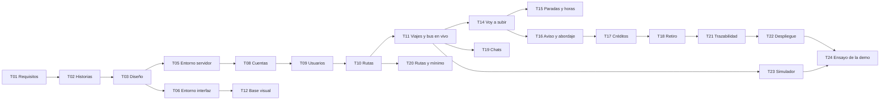
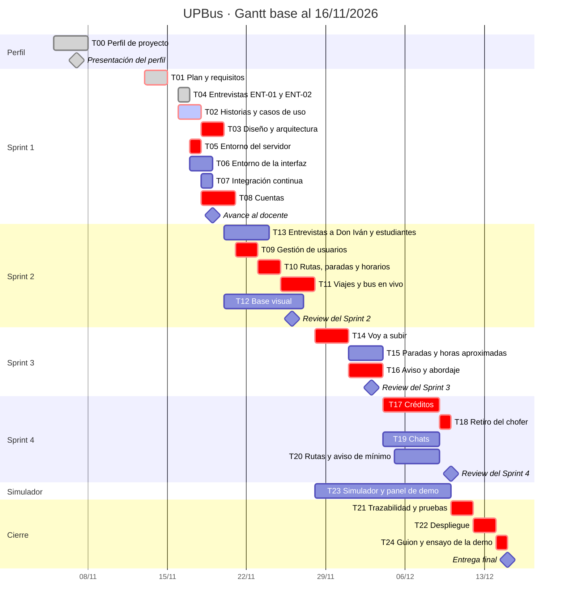

# Sesiones 8 y 9 — Plan del MVP (Scrum, por sprints)

- Proyecto: UPBus — Buses UPB en tiempo real (UPB Santa Cruz)
- Repositorio: [UPBus](https://github.com/hugozuniga770/UPBus)
- Integrantes: Hugo Zuñiga (Product Owner), Andrés Laura Vargas (Scrum Master) y Sebastian Cruz. Los tres son Developers.
- Docente: Ing. Alejandro Rodríguez (Certificación I)
- Fecha del plan: 13/11/2026 · Avance: jueves 19/11/2026 · Entrega final: martes 15/12/2026
- Actualizado: 16/11/2026 · entrevistas, tareas T23 y T24, Gantt detallado y costos (C-07, C-08, C-12, C-13)
- Issue: por crear · Milestone: Sprint 1
- Requisitos: [Sesión 6](sesion-06-requisitos.md) · Cambios: [cambios.md](cambios.md)

## 1. Punto de partida

- El 07/11/2026 se presentó el perfil del proyecto: problema, árbol de problemas, objetivos y 12 historias iniciales.
- El 13/11/2026 el Product Owner tomó las decisiones que originan este plan (fuente PO13 de los requisitos).
- El equipo pasó de cuatro a tres integrantes: Ismael dejó el grupo y queda en el padrón como estudiante de prueba.
- Se toma como referencia de estilo y organización el proyecto de reserva de salas (documentos por sesión, capas `views` → `servicios` → `reglas`, un test por criterio de aceptación).
- El repositorio empieza vacío: todavía no hay código.

## 2. Alcance del MVP

El alcance completo está en la [sección 2 de los requisitos](sesion-06-requisitos.md). Se entrega por incrementos:

| Sprint | Incremento que debe funcionar |
|---|---|
| Sprint 1 | Documentación base, entorno, registro con el padrón e inicio de sesión por rol |
| Sprint 2 | Gestión de usuarios, rutas con paradas y horarios en el mapa, viajes y bus en vivo (simulado) |
| Sprint 3 | «Voy a subir», ubicación del estudiante (simulada), paradas propuestas, horas aproximadas, aviso de bus cerca y registro de quién subió |
| Sprint 4 | Créditos (recarga, pago, comprobante, devolución y retiro), chats, modificación de rutas y aviso de mínimo |
| Cierre | Pruebas completas, trazabilidad, despliegue en hosting gratuito y ensayo de la defensa |

## 3. Método: Scrum

- **Sprints de una semana**, de viernes a jueves. El último tramo (11 al 15 de diciembre) es de cierre.
- **Roles:** el Product Owner ordena el backlog y aprueba; el Scrum Master cuida el método y quita lo que traba al equipo; los tres desarrollan.
- **Eventos:** Sprint Planning el viernes, Daily Scrum de 15 minutos cada día hábil, y Sprint Review y Retrospectiva el jueves.
- **Ramas:** nadie sube directo a `main`. Cada historia se trabaja en su rama (`hu-07-voy-a-subir`), entra a `develop` por Pull Request y la aprueba Hugo. Solo Hugo une `develop` con `main`, al cerrar cada sprint.
- **Commits:** cada commit cita su issue con `#n` y empieza con su historia (`HU-07: …`).
- **Cambios:** si algo ya acordado cambia, no se cambia en silencio: se registra en `docs/cambios.md` con motivo y fecha, y después se corrige.
- **Pruebas:** los criterios de aceptación se definen en la sesión 7 y cada uno es exactamente un test.
- **Definition of Done:** la historia cumple todos sus criterios; cada criterio tiene su test y pasa; el Pull Request está aprobado por Hugo; la integración continua pasa en verde; se ve bien en celular y computadora; la documentación afectada está al día.

## 4. Tareas

Las estimaciones son en horas-persona (h-p) y son **[PROPUESTA]**: no hay horas medidas de un trabajo parecido. Las horas reales se registran en la hoja de costos ([sesión 15](sesion-15-costos.md)).

| ID | Trabajo | Evidencia de terminación | Esfuerzo (h-p) | Responsable | Sprint | Estado al 16/11 |
|---|---|---|---:|---|---|---|
| T00 | Perfil de proyecto: informe y presentación | Presentado el 07/11/2026 | 6 | Los tres | Perfil | Hecho |
| T01 | Plan y requisitos | `sesion-08-09-plan.md` y `sesion-06-requisitos.md` aprobados | 4 | Hugo | 1 | En revisión |
| T02 | Historias, criterios y casos de uso | `sesion-07-modelos.md` aprobado | 5 | Hugo | 1 | Por hacer |
| T03 | Diseño y arquitectura | `sesion-13-14-diseno.md`, `sesion-12-arquitectura.md` y `diagramas-secuencia.md` aprobados | 5 | Hugo y Sebastian | 1 | En curso |
| T04 | Entrevistas a un chofer y a una estudiante (ENT-01, ENT-02) | Registros en `entrevistas.md` y cambios derivados | 2 | Hugo | 1 | Hecho (16/11) |
| T05 | Entorno del servidor | Django, DRF y Channels arrancan; SQLite creada | 3 | Andrés | 1 | Por hacer |
| T06 | Entorno de la interfaz | React con Tailwind arranca y habla con la API | 3 | Andrés | 1 | Por hacer |
| T07 | Integración continua | GitHub Actions corre pytest y Vitest por separado | 2 | Andrés | 1 | Por hacer |
| T08 | Padrón, registro e inicio de sesión (HU-01, HU-02) | Tests de HU-01 y HU-02 en verde; pantallas de registro e inicio de sesión | 8 | Hugo | 1 | Por hacer |
| T09 | Gestión de usuarios (HU-03) | El administrador crea y elimina choferes y personas | 4 | Hugo | 2 | Por hacer |
| T10 | Rutas, paradas y horarios (HU-04) | Comando `cargar_rutas`; las rutas se ven en el mapa | 8 | Sebastian | 2 | Por hacer |
| T11 | Viajes y bus en vivo (HU-05, HU-06) | El chofer inicia el viaje; el simulador mueve el bus en el mapa por WebSocket | 10 | Sebastian | 2 | Por hacer |
| T12 | Base visual | Estilo UPB, navegación por rol y componentes comunes | 6 | Andrés | 2 | Por hacer |
| T13 | Entrevistas a Don Iván (ENT-03), a la encargada del servicio en la UPB (ENT-07) y a estudiantes de otras rutas | Registros en `entrevistas.md` y cambios derivados | 4 | Andrés (ENT-03, ENT-07) y Hugo (estudiantes) | 1 y 2 | En curso: ENT-03 hecha el 18/11 |
| T14 | «Voy a subir» y ubicación del estudiante (HU-07) | Alerta al chofer; el aviso se cancela solo si no sube | 8 | Sebastian | 3 | Por hacer |
| T15 | Paradas propuestas y horas aproximadas (HU-08) | Paradas activas; hora aproximada por parada | 8 | Sebastian | 3 | Por hacer |
| T16 | Aviso de bus cerca y registro de quién subió (HU-09, HU-10) | Aviso a 500 m; «ha subido» en la lista del chofer | 6 | Andrés | 3 | Por hacer |
| T17 | Créditos: recarga y pago (HU-11, HU-12) | Recarga aprobada; cobro al subir; comprobante | 10 | Hugo | 3 y 4 | Por hacer |
| T18 | Retiro del chofer (HU-13) | El chofer retira y el saldo no queda negativo | 3 | Hugo | 4 | Por hacer |
| T19 | Chats (HU-14, HU-15) | Chat directo y chat de ruta por WebSocket | 8 | Andrés | 4 | Por hacer |
| T20 | Modificación de rutas y aviso de mínimo (HU-16, HU-17) | Cambio grande pendiente de aprobación; aviso con menos de 15 | 6 | Sebastian | 4 | Por hacer |
| T21 | Trazabilidad y pruebas completas | `trazabilidad.md` completa; todos los tests en verde | 5 | Los tres | Cierre | Por hacer |
| T22 | Despliegue en hosting gratuito | App publicada con HTTPS | 5 | Los tres | Cierre | Por hacer |
| T23 | Simulador de escenarios y panel de demo | Los escenarios corren desde la terminal y desde el panel, usando los mismos servicios que la app | 10 | Sebastian | 2 a 4 | Por hacer |
| T24 | Guion y ensayo de la demo | Recorrido ensayado y cronometrado; video de respaldo | 3 | Los tres | Cierre | Por hacer |

Esfuerzo total: **142 h-p**: 136 desde el Sprint 1 y 6 del perfil, que ya se hizo.

| Tramo | h-p estimadas | Contra la capacidad de 24 h-p |
|---|---:|---|
| Perfil | 6 | Hecho |
| Sprint 1 | 32 | La supera en 8 |
| Sprint 2 | 35 (incluye 3 de T23) | La supera en 11 |
| Sprint 3 | 30 (incluye 5 de T17 y 3 de T23) | La supera en 6 |
| Sprint 4 | 26 (incluye 5 de T17 y 4 de T23) | La supera en 2 |
| Cierre | 13 | — |

**Reparto** **[ACUERDO]** (PO13):

- **Hugo:** cuentas, padrón y créditos, además de la documentación y las entrevistas.
- **Sebastian:** rutas, viajes, mapa y simulador.
- **Andrés:** mensajes, base de la interfaz e integración continua.

Horas estimadas por persona, con las tareas compartidas repartidas por igual: Hugo 48,8; Sebastian 58,8; Andrés 34,3 ([sesión 15](sesion-15-costos.md), sección 7).

**Qué hace cada uno en el Sprint 1.** En Scrum los tres trabajan desde el primer sprint, no solo desde que empieza el código:

| Integrante | Sprint 1 |
|---|---|
| Hugo | T01, T02, T04 y T08; T03 con Sebastian |
| Sebastian | T03 con Hugo; revisa los diagramas de secuencia de rutas, viajes y bus en vivo |
| Andrés | T05, T06 y T07; arma el tablero de GitHub Projects, la rama `develop` y la protección de `main` |

## 5. Orden y dependencias

La cadena más larga es T01 → T02 → T03 → T05 → T08 → T09 → T10 → T11 → T14 → T16 → T17 → T18 → T21 → T22 → T24. Un atraso en ella atrasa la entrega.

## 6. Calendario

| Sprint | Fechas | Planning | Review y Retrospectiva |
|---|---|---|---|
| Sprint 1 | 13/11 al 19/11 | vie 13/11 | jue 19/11 (avance al docente) |
| Sprint 2 | 20/11 al 26/11 | vie 20/11 | jue 26/11 |
| Sprint 3 | 27/11 al 03/12 | vie 27/11 | jue 03/12 |
| Sprint 4 | 04/12 al 10/12 | vie 04/12 | jue 10/12 |
| Cierre | 11/12 al 15/12 | vie 11/12 | mar 15/12 (entrega final) |

### 6.1 Gantt base

Cómo leerlo: las barras grises claras ya están hechas, la de color fuerte está en curso y las rojas son la cadena más larga de la sección 5. Cada tarea empieza cuando termina la anterior de su cadena.

**Lo que muestra el Gantt.** T08 (cuentas) termina el 20/11, un día después del avance, y T11 (bus en vivo) termina el 27/11, ya en el Sprint 3. El plan entra en la fecha final (T24 termina el 14/12), pero sin holgura: cualquier atraso en la cadena roja llega al 15/12. Ver el riesgo 7.

### 6.2 Gantt real

Al cerrar cada sprint se anota aquí lo que de verdad pasó, comparado con el Gantt base.

| Tarea | Inicio planificado | Fin planificado | Inicio real | Fin real | Diferencia |
|---|---|---|---|---|---|
| T00 | 05/11 | 07/11 | — | 07/11 | Se presentó a tiempo |
| T01 | 13/11 | 14/11 | 13/11 | En revisión | Se ajustó el 16/11 con las entrevistas |
| T04 | 13/11 | 13/11 | 16/11 | 16/11 | 3 días después: no se encontró a Don Iván |

## 7. Disponibilidad y capacidad

- Capacidad supuesta **[PROVISIONAL]**: 8 horas por persona por sprint, es decir 24 h-p por sprint y 96 h-p en cuatro sprints, más unas 12 h-p en el cierre.
- El trabajo estimado desde el Sprint 1 (136 h-p) **supera** esa capacidad (108 h-p) en unas 28 h-p, cerca de un 26 %. Por eso los recortes de la sección 9 están aprobados de antemano.
- Las estimaciones no incluyen los eventos de Scrum (Planning, Daily, Review y Retrospectiva), unas 45 h-p más ([sesión 15](sesion-15-costos.md), sección 9).
- Cada integrante confirma sus horas reales en el Sprint Planning.

## 8. Riesgos

| # | Riesgo | Señal de alerta | Respuesta |
|---|---|---|---|
| 1 | El alcance creció (créditos, paradas que aprenden, cambios de ruta) con un integrante menos | Al cerrar el Sprint 2 no funciona el bus en vivo | Aplicar los recortes de la sección 9, en orden |
| 2 | WebSockets en un hosting gratuito | El chat o el mapa no se actualizan fuera de la computadora local | Probar el despliegue en el Sprint 2, no al final |
| 3 | El GPS real no funciona con la pantalla apagada | — | Queda [SIMULADO] en el MVP. En el servicio real, la pantalla del bus con la página abierta (ENT-01, P-20) |
| 4 | Las entrevistas cambian las reglas | Ya pasó: ENT-01 espera 2 minutos y el docente dijo que no se espera (P-19) | Registrar el cambio en `cambios.md` y ajustar el backlog en el siguiente Planning |
| 5 | Los créditos tienen errores de saldo | Un test de pago falla o un saldo queda negativo | Todo movimiento se guarda completo o no se guarda; pruebas de doble envío |
| 6 | Datos personales reales en un repositorio público | Códigos o correos reales en el padrón | Usar datos de ejemplo hasta responder P-01 |
| 7 | No hay incremento que funcione para el avance del 19/11 | El Gantt base ya muestra que T08 termina el 20/11 | El Product Owner decide si el objetivo del Sprint 1 es documentación y entorno, y pasa T08 al Sprint 2 |
| 8 | Solo se entrevistó la Ruta Norte | Las otras rutas tienen problemas distintos | ENT-04 a ENT-06 con estudiantes de otras rutas, en el Sprint 2 |
| 9 | La UPB pensaba hacer su propia aplicación de transporte el próximo año (ENT-03) | La encargada del servicio confirma un proyecto propio | Preguntarlo en ENT-07 y presentar UPBus como prueba piloto de esa idea |

## 9. Recortes aprobados (en este orden)

**[PROPUESTA]** hasta que el Product Owner los confirme. El orden cambió el 16/11 por lo que dijeron las entrevistas (C-12). Si falta tiempo, se recorta desde arriba:

1. Modificación de rutas por el chofer (RF-21): solo el administrador edita. ENT-01: el chofer cambia de ruta «casi nunca».
2. Paradas propuestas (RF-10): solo paradas cargadas por el administrador. ENT-01 y ENT-02: los estudiantes suben siempre en los mismos puntos y no propondrían paradas.
3. Sugerencia de saltar una parada (RF-12).
4. Chat de la ruta (RF-20): queda el chat directo.
5. Retiro del chofer (RF-18): solo se muestra su saldo.
6. Horas aproximadas aprendidas (RF-11): horas fijas por parada.

No se recortan: registro, inicio de sesión, bus en vivo (lo que más pidieron las dos entrevistas), «Voy a subir» y registro de quién subió.

## 10. Entregables e hitos

| Hito | Fecha | Qué se muestra | Estado |
|---|---|---|---|
| Perfil | 07/11/2026 | Informe y presentación del perfil | Hecho |
| Entrevistas | 16/11/2026 | ENT-01 (chofer) y ENT-02 (estudiante) | Hecho |
| Avance | 19/11/2026 | Documentación de las sesiones 6 a 15 y el incremento del Sprint 1 | Pendiente · riesgo 7 |
| Review Sprint 2 | 26/11/2026 | Bus en vivo en el mapa | Pendiente |
| Review Sprint 3 | 03/12/2026 | «Voy a subir» de punta a punta | Pendiente |
| Review Sprint 4 | 10/12/2026 | Créditos y chats | Pendiente |
| Entrega final | 15/12/2026 | App desplegada, pruebas en verde y demo con el simulador | Pendiente |

Al cerrar cada sprint se anota aquí la fecha real y el SHA del commit de cierre.

## 11. Cambios al plan

| Fecha | Cambio | Motivo |
|---|---|---|
| 13/11/2026 | Primera versión del plan | — |
| 14/11/2026 | Se agregan T23 (simulador y panel de demo, 10 h-p) y T24 (guion y ensayo de la demo, 3 h-p); T22 queda solo para el despliegue (C-07) | Mostrar en clase que la app funciona |
| 16/11/2026 | T04 queda hecha con ENT-01 y ENT-02; T13 pasa a Don Iván y a estudiantes de otras rutas (C-08) | No se encontró a Don Iván; el chofer entrevistado coordina con él |
| 16/11/2026 | Nuevo orden de los recortes (C-12, propuesto) | Lo que dijeron ENT-01 y ENT-02 |
| 17/11/2026 | ENT-03 y ENT-07 pasan a Andrés y se adelantan al 18/11 (C-14) | Reparto de trabajo |
| 18/11/2026 | ENT-03 hecha; ENT-07 queda pendiente con la encargada del servicio en la UPB (C-15) | Don Iván indicó con quién coordina |
| 16/11/2026 | Se agregan T00 (perfil, ya hecho) al conteo, el Gantt detallado y el Gantt real | Llevar las cuentas del proyecto (sesión 15) |

## 12. Dudas abiertas

Las preguntas P-01 a P-24 están en la [sección 6 de los requisitos](sesion-06-requisitos.md). Para este plan pesan sobre todo P-06 (horas de llegada), P-16 (hosting), P-18 (paradas reales), P-19 (espera) y P-20 (pantalla del bus). La decisión del riesgo 7 también es del Product Owner.

## 13. Participación y asistencia utilizada

- **Hugo Zuñiga:** definió los sprints, el reparto y las fechas, hizo las entrevistas del 16/11 y aprueba este plan.
- **Asistencia de IA:** se usó Claude (Anthropic) para proponer las tareas, las estimaciones, el orden y los riesgos a partir de las decisiones del Product Owner, y el 16/11 para ajustar el plan con las entrevistas y dibujar el Gantt.
