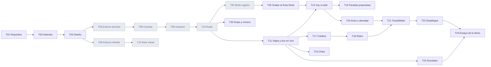
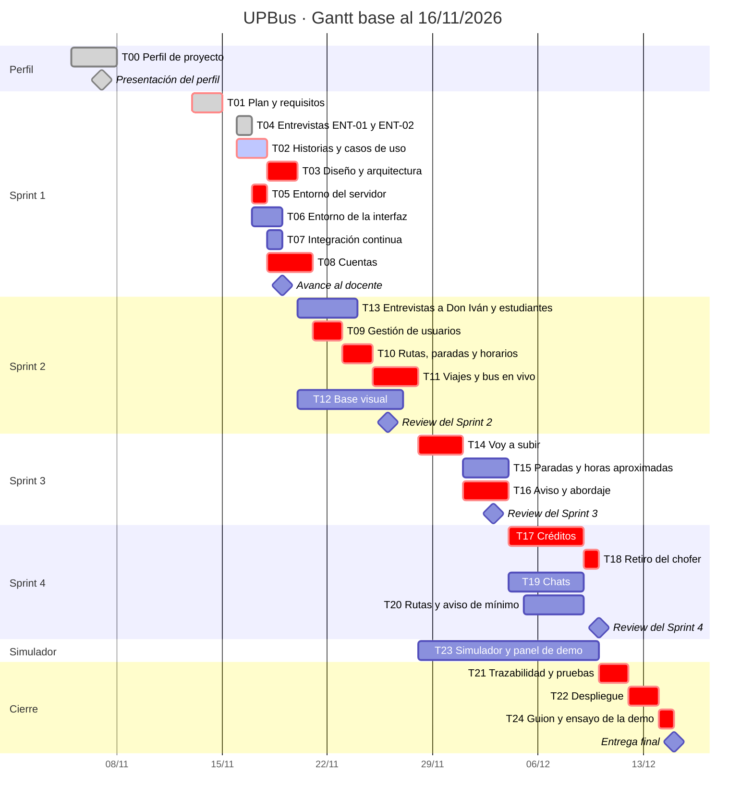
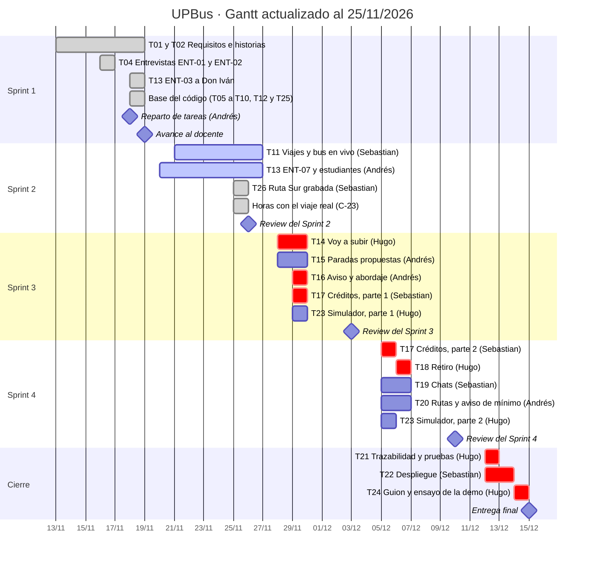

# Sesiones 8 y 9 — Plan del MVP (Scrum, por sprints)

- Proyecto: UPBus — Buses UPB en tiempo real (UPB Santa Cruz)
- Repositorio: [UPBus](https://github.com/hugozuniga770/UPBus)
- Integrantes: Hugo Zuñiga (Product Owner), Andrés Laura Vargas (Scrum Master) y Sebastian Cruz. Los tres son Developers.
- Docente: Ing. Alejandro Rodríguez (Certificación I)
- Fecha del plan: 13/11/2026 · Avance: jueves 19/11/2026 · Entrega final: martes 15/12/2026
- Actualizado: 25/11/2026 · reparto del 18/11 en la tabla de tareas (C-26), primera ruta grabada con el modo registro (T26, C-24) y Gantt al 25/11; esa noche, evidencias de T14, T16, T17, T20 y T23 ajustadas a la revisión de las historias del Product Owner (C-28 a C-32). El 18/11/2026: base del código, tareas T25 y T26, Andrés como Scrum Master de la implementación y sesiones de sábado y domingo (C-18 a C-20). Antes, 16/11/2026: entrevistas, T23 y T24, Gantt detallado y costos (C-07, C-08, C-12, C-13)
- Issue: [#1](https://github.com/hugozuniga770/UPBus/issues/1) · Milestone: Sprint 1
- Requisitos: [Sesión 6](sesion-06-requisitos.md) · Historias: [Sesión 7](sesion-07-modelos.md) · Cambios: [cambios.md](cambios.md)

## 1. Punto de partida

- El 07/11/2026 se presentó el perfil del proyecto: problema, árbol de problemas, objetivos y 12 historias iniciales.
- El 13/11/2026 el Product Owner tomó las decisiones que originan este plan (fuente PO13 de los requisitos).
- El equipo pasó de cuatro a tres integrantes: Ismael dejó el grupo y queda en el padrón como estudiante de prueba.
- Se toma como referencia de estilo y organización el proyecto de reserva de salas (documentos por sesión, capas `views` → `servicios` → `reglas`, un test por criterio de aceptación).
- El repositorio empezó vacío. El 18/11/2026 Hugo dejó la **base del código** (C-19): entornos, integración continua, cuentas, usuarios, rutas en el mapa y modo registro, con 22 tests de servidor y 8 de interfaz en verde. Entra a `develop` por Pull Request.
- Desde la base, **Andrés Laura Vargas dirige la implementación como Scrum Master**: supervisa que cada tarea se cumpla y reparte quién hace cada una y quién se encarga de las pruebas.

## 2. Alcance del MVP

El alcance completo está en la [sección 2 de los requisitos](sesion-06-requisitos.md). Se entrega por incrementos:

| Sprint | Incremento que debe funcionar |
|---|---|
| Sprint 1 | Documentación base, entorno, registro con el padrón e inicio de sesión por rol. Adelantado en la base: gestión de usuarios, rutas en el mapa y modo registro |
| Sprint 2 | Ruta Norte grabada con el modo registro en un viaje real, viajes y bus en vivo (simulado) |
| Sprint 3 | «Voy a subir», ubicación del estudiante (simulada), paradas propuestas, horas aproximadas, aviso de bus cerca y registro de quién subió |
| Sprint 4 | Créditos (recarga, pago, comprobante, devolución y retiro), chats, modificación de rutas y aviso de mínimo |
| Cierre | Pruebas completas, trazabilidad, despliegue en hosting gratuito y ensayo de la defensa |

## 3. Método: Scrum

- **Sprints de una semana**, de viernes a jueves. El último tramo (11 al 15 de diciembre) es de cierre.
- **Roles:** el Product Owner ordena el backlog y aprueba; el Scrum Master cuida el método y quita lo que traba al equipo; los tres desarrollan. En la implementación, Andrés Laura Vargas, como Scrum Master, reparte las tareas en el Sprint Planning, decide quién se encarga de las pruebas y revisa en cada Daily que las tareas avancen (C-19).
- **Eventos:** la implementación se hace en **sesiones de sábado y domingo** (C-19). El Sprint Planning es al empezar la sesión del sábado y lo dirige Andrés; el Daily Scrum, de 15 minutos, al empezar cada sesión y, entre semana, con un mensaje en el grupo (qué hice, qué haré, qué me traba); la Sprint Review y la Retrospectiva, el jueves.
- **Ramas:** nadie sube directo a `main`. Cada historia se trabaja en su rama (`hu-07-voy-a-subir`), entra a `develop` por Pull Request y la aprueba Hugo. Solo Hugo une `develop` con `main`, al cerrar cada sprint.
- **Commits:** cada commit cita su issue con `#n` y empieza con su historia (`HU-07: …`).
- **Cambios:** si algo ya acordado cambia, no se cambia en silencio: se registra en `docs/cambios.md` con motivo y fecha, y después se corrige.
- **Pruebas:** los criterios de aceptación están en la [sesión 7](sesion-07-modelos.md), cada uno con el nombre de su test. Primero se escribe el test y se lo ve fallar; después, el código.
- **Definition of Done:** la historia cumple todos sus criterios; cada criterio tiene su test y pasa; el Pull Request está aprobado por Hugo; la integración continua pasa en verde; se ve bien en celular y computadora; la documentación afectada está al día.

## 4. Tareas

Las estimaciones son en horas-persona (h-p) y son **[PROPUESTA]**: no hay horas medidas de un trabajo parecido. Las horas reales se registran en la hoja de costos ([sesión 15](sesion-15-costos.md)).

| ID | Trabajo | Evidencia de terminación | Esfuerzo (h-p) | Responsable | Sprint | Estado al 25/11 |
|---|---|---|---:|---|---|---|
| T00 | Perfil de proyecto: informe y presentación | Presentado el 07/11/2026 | 6 | Los tres | Perfil | Hecho |
| T01 | Plan y requisitos | `sesion-08-09-plan.md` y `sesion-06-requisitos.md` aprobados | 4 | Hugo | 1 | En revisión: el 18/11 se sumó RF-23 |
| T02 | Historias, criterios y casos de uso | `sesion-07-modelos.md` aprobado | 5 | Hugo | 1 | En revisión: escrito el 18/11; el Product Owner lo revisó el 25/11 (PO25) |
| T03 | Diseño y arquitectura | `sesion-13-14-diseno.md`, `sesion-12-arquitectura.md` y `diagramas-secuencia.md` aprobados | 5 | Andrés; Hugo hizo las secuencias y el diseño de la base | 1 | En curso: falta `sesion-12-arquitectura.md` |
| T04 | Entrevistas a un chofer y a una estudiante (ENT-01, ENT-02) | Registros en `entrevistas.md` y cambios derivados | 2 | Hugo | 1 | Hecho (16/11) |
| T05 | Entorno del servidor | Django, DRF y Channels arrancan; SQLite creada | 3 | Hugo (antes Andrés, C-19) | 1 | Hecho en la base |
| T06 | Entorno de la interfaz | React con Tailwind arranca y habla con la API | 3 | Hugo (antes Andrés, C-19) | 1 | Hecho en la base |
| T07 | Integración continua | GitHub Actions corre pytest y Vitest por separado | 2 | Hugo (antes Andrés, C-19) | 1 | Hecho en la base |
| T08 | Padrón, registro e inicio de sesión (HU-01, HU-02) | Tests de HU-01 y HU-02 en verde; pantallas de registro e inicio de sesión | 8 | Hugo | 1 | Hecho en la base: 8 criterios en verde |
| T09 | Gestión de usuarios (HU-03) | El administrador crea y elimina choferes y personas | 4 | Hugo | 1 (estaba en el 2) | Hecho en la base: 4 criterios en verde |
| T10 | Rutas, paradas y horarios (HU-04) | Comando `cargar_rutas`; las rutas se ven en el mapa | 8 | Hugo (antes Sebastian, C-19) | 1 (estaba en el 2) | Hecho en la base: 2 criterios en verde |
| T11 | Viajes y bus en vivo (HU-05, HU-06) | El chofer inicia el viaje; el simulador mueve el bus en el mapa por WebSocket | 10 | Sebastian | 2 | Hecho: viajes, GPS, última posición, pasos a menos de 50 m y mapa por WebSocket (#6) |
| T12 | Base visual | Estilo UPB, navegación por rol y componentes comunes | 6 | Hugo (antes Andrés, C-19) | 1 (estaba en el 2) | Hecho en la base; cada historia suma sus pantallas |
| T13 | Entrevistas a Don Iván (ENT-03), a la encargada del servicio en la UPB (ENT-07) y a estudiantes de otras rutas | Registros en `entrevistas.md` y cambios derivados | 4 | Andrés (ENT-03, ENT-07) y Hugo (estudiantes) | 1 y 2 | En curso: ENT-03 hecha el 18/11 |
| T14 | «Voy a subir» y ubicación del estudiante (HU-07) | Alerta al chofer; el aviso queda «no se presentó» si el bus llega a la parada siguiente sin que suba | 8 | Hugo | 3 | Hecho: «Voy a subir», cancelar, ubicación compartida y cierre automático; HU07-CA6 llega con T16 |
| T15 | Paradas propuestas y su aprobación (HU-08) | Proponer en el mapa; el administrador aprueba o rechaza, también las que graba un chofer; paradas activas | 8 | Andrés | 3 | Por hacer: las horas aproximadas ya están en la base |
| T16 | Aviso de bus cerca y registro de quién subió (HU-09, HU-10) | Aviso a 500 m; sugerencia de seguir al chofer; «ha subido» en la lista del chofer, también cuando la app detecta que subió | 6 | Andrés | 3 | Por hacer |
| T17 | Créditos: recarga y pago (HU-11, HU-12) | Recarga aprobada; ajustes del administrador; pago desde la app con comprobante; el chofer revisa los comprobantes y marca el efectivo | 10 | Sebastian | 3 y 4 | Por hacer |
| T18 | Retiro del chofer (HU-13) | El chofer retira y el saldo no queda negativo | 3 | Hugo | 4 | Por hacer |
| T19 | Chats (HU-14, HU-15) | Chat directo y chat de ruta por WebSocket | 8 | Sebastian | 4 | Por hacer |
| T20 | Modificación de rutas y aviso de mínimo (HU-16, HU-17) | Todo cambio del chofer pendiente de aprobación; aviso con menos de 15 | 6 | Andrés | 4 | Por hacer |
| T21 | Trazabilidad y pruebas completas | `trazabilidad.md` completa; todos los tests en verde | 5 | Hugo | Cierre | Empezada: `trazabilidad.md` llega con la base |
| T22 | Despliegue en hosting gratuito | App publicada con HTTPS | 5 | Sebastian | Cierre | Por hacer |
| T23 | Simulador de escenarios y panel de demo | Los escenarios corren desde la terminal y desde el panel, usando los mismos servicios que la app; los viajes simulados no cambian las horas aproximadas | 10 | Hugo | 2 a 4 | En curso: comando, panel Demo y escenarios «recorrido» y «no se presenta» unidos (PR #27); faltan los de T16 y T17 |
| T24 | Guion y ensayo de la demo | Recorrido ensayado y cronometrado; video de respaldo | 3 | Hugo | Cierre | Por hacer |
| T25 | Modo registro de paradas y horas (HU-18) | 5 criterios en verde; una ruta grabada desde el celular por el túnel HTTPS | 8 | Hugo | 1 | Hecho en la base (C-18) |
| T26 | Grabar la primera ruta con el modo registro | Paradas y horas de una ruta en la app; respaldo en `rutas/datos/registros/` y viaje en `viajes-grabados.md` | 2 | Sebastian | 2 | Hecho el 25/11: Ruta Sur, ingreso de las 06:40 (REG-01) |

Esfuerzo total: **152 h-p**: 146 desde el Sprint 1 y 6 del perfil, que ya se hizo. T25 y T26 suman 10 h-p a las 142 del 16/11 (C-18).

| Tramo | h-p estimadas | Contra la capacidad de 24 h-p |
|---|---:|---|
| Perfil | 6 | Hecho |
| Sprint 1 | 58 (la base adelantó T09, T10 y T12 del Sprint 2 y sumó T25) | La supera en 34; las horas reales se anotan en la hoja de costos |
| Sprint 2 | 19 (T11, T13, T26 y 3 de T23) | Queda 5 por debajo: holgura para probar el despliegue (riesgo 2) |
| Sprint 3 | 30 (incluye 5 de T17 y 3 de T23) | La supera en 6 |
| Sprint 4 | 26 (incluye 5 de T17 y 4 de T23) | La supera en 2 |
| Cierre | 13 | — |

**Reparto del 18/11** **[ACUERDO]** (C-19, C-26). En la reunión del 18/11, dirigida por Andrés como Scrum Master, cada uno tomó sus tareas y quedó asignado en su issue de GitHub:

| Integrante | Tareas | Issues |
|---|---|---|
| Hugo Zuñiga | La base del código (T05 a T10, T12 y T25), T02, T14 («Voy a subir»), T18 (retiro), T21 (trazabilidad), T23 (simulador) y T24 (demo) | [#2](https://github.com/hugozuniga770/UPBus/issues/2), [#9](https://github.com/hugozuniga770/UPBus/issues/9), [#13](https://github.com/hugozuniga770/UPBus/issues/13), [#16](https://github.com/hugozuniga770/UPBus/issues/16), [#8](https://github.com/hugozuniga770/UPBus/issues/8), [#18](https://github.com/hugozuniga770/UPBus/issues/18) |
| Sebastian Cruz | T26 (grabar rutas), T11 (viajes y bus en vivo), T17 (créditos), T19 (chats) y T22 (despliegue) | [#5](https://github.com/hugozuniga770/UPBus/issues/5), [#6](https://github.com/hugozuniga770/UPBus/issues/6), [#12](https://github.com/hugozuniga770/UPBus/issues/12), [#14](https://github.com/hugozuniga770/UPBus/issues/14), [#17](https://github.com/hugozuniga770/UPBus/issues/17) |
| Andrés Laura Vargas | Revisión de T01, T03 (arquitectura), T13 (entrevistas), T15 (paradas propuestas), T16 (aviso y abordaje) y T20 (rutas y mínimo) | [#1](https://github.com/hugozuniga770/UPBus/issues/1), [#3](https://github.com/hugozuniga770/UPBus/issues/3), [#7](https://github.com/hugozuniga770/UPBus/issues/7), [#10](https://github.com/hugozuniga770/UPBus/issues/10), [#11](https://github.com/hugozuniga770/UPBus/issues/11), [#15](https://github.com/hugozuniga770/UPBus/issues/15) |

Horas estimadas por persona: Hugo 88,5, Sebastian 37 y Andrés 26,5 ([sesión 15](sesion-15-costos.md), sección 7). Andrés revisa en cada Daily que las tareas avancen. Cada integrante puede trabajar su tarea con un asistente de IA siguiendo `AGENTS.md`, y lo declara en la participación de su parte.

**Qué hace cada uno en el Sprint 1.** En Scrum los tres trabajan desde el primer sprint, no solo desde que empieza el código:

| Integrante | Sprint 1 |
|---|---|
| Hugo | T01, T02, T04 y la base del código (T05 a T10, T12 y T25); T03 con Sebastian |
| Sebastian | T03 con Hugo; revisa HU-04 a HU-06 y HU-18 en la sesión 7; prepara T26 con la [guía del modo registro](https://github.com/hugozuniga770/UPBus/blob/develop/docs/guia-modo-registro.md) |
| Andrés | ENT-03 y ENT-07 (T13); revisa el Pull Request de la base; arma el tablero de GitHub Projects y la protección de `main`; dirige el reparto del 18/11 |

## 5. Orden y dependencias

Las tareas en gris ya están hechas (al 18/11).

Con la base hecha, la cadena más larga es T11 → T14 → T16 → T21 → T22 → T24. Un atraso en ella atrasa la entrega. Desde el 25/11, T17 ya no espera a T16, porque subir no cobra (C-31): corre en paralelo, T11 → T17 → T18 → T21. El Gantt base (6.1) queda como se planificó. T26 tiene que estar antes de T14: sin paradas reales no hay dónde marcar «Voy a subir».

## 6. Calendario

| Sprint | Fechas | Sesiones de implementación (C-19) | Planning | Review y Retrospectiva |
|---|---|---|---|---|
| Sprint 1 | 13/11 al 19/11 | — (la base la dejó Hugo el 18/11) | vie 13/11 | jue 19/11 (avance al docente) |
| Sprint 2 | 20/11 al 26/11 | sáb 21/11 y dom 22/11 | sáb 21/11, al empezar | jue 26/11 |
| Sprint 3 | 27/11 al 03/12 | sáb 28/11 y dom 29/11 | sáb 28/11 | jue 03/12 |
| Sprint 4 | 04/12 al 10/12 | sáb 05/12 y dom 06/12 | sáb 05/12 | jue 10/12 |
| Cierre | 11/12 al 15/12 | sáb 12/12 y dom 13/12 **[PROPUESTA]** | sáb 12/12 | mar 15/12 (entrega final) |

### 6.1 Gantt base

Cómo leerlo: las barras grises claras ya están hechas, la de color fuerte está en curso y las rojas son la cadena más larga de la sección 5. Cada tarea empieza cuando termina la anterior de su cadena.

**Lo que muestra el Gantt.** T08 (cuentas) termina el 20/11, un día después del avance, y T11 (bus en vivo) termina el 27/11, ya en el Sprint 3. El plan entra en la fecha final (T24 termina el 14/12), pero sin holgura: cualquier atraso en la cadena roja llega al 15/12. Ver el riesgo 7.

### 6.2 Gantt real

Al cerrar cada sprint se anota aquí lo que de verdad pasó, comparado con el Gantt base.

| Tarea | Inicio planificado | Fin planificado | Inicio real | Fin real | Diferencia |
|---|---|---|---|---|---|
| T00 | 05/11 | 07/11 | — | 07/11 | Se presentó a tiempo |
| T01 | 13/11 | 14/11 | 13/11 | En revisión | Se ajustó el 16/11 con las entrevistas |
| T04 | 13/11 | 13/11 | 16/11 | 16/11 | 3 días después: no se encontró a Don Iván |
| T02 | 16/11 | 17/11 | 16/11 | 18/11 (en revisión) | 1 día después; se sumó HU-18 |
| T05 a T08 | 17/11 | 20/11 | 18/11 | 18/11 | 2 días antes, en la base (C-19) |
| T09, T10 y T12 | 20/11 | 26/11 | 18/11 | 18/11 | Se adelantaron al Sprint 1, en la base |
| T25 | — | — | 18/11 | 18/11 | Tarea nueva (C-18) |
| T26 | 20/11 | 23/11 | 25/11 | 25/11 | Dentro del Sprint 2, con la Ruta Sur (C-24) |
| T13 (ENT-03) | 20/11 | 23/11 | 18/11 | 18/11 | Se adelantó (C-14) |

### 6.3 Gantt actualizado al 25/11/2026

Con la base terminada, el reparto del 18/11 y la primera ruta grabada. El Gantt base de la sección 6.1 no se borra: es contra lo que se compara lo real. Entre paréntesis, quién tomó cada tarea.

**Lo que muestra.** El Sprint 2 cierra el 26/11 con la primera ruta real en la app y T11 en curso. La Ruta Sur ya tiene paradas, así que T11 y T14 se prueban con datos reales. La presión sigue en los fines de semana del Sprint 3 y del Sprint 4, que tienen más horas que la capacidad (sección 4). Si una sesión no alcanza, se aplican los recortes de la sección 9.

## 7. Disponibilidad y capacidad

- Capacidad supuesta **[PROVISIONAL]**: 8 horas por persona por sprint, es decir 24 h-p por sprint y 96 h-p en cuatro sprints, más unas 12 h-p en el cierre.
- El trabajo estimado desde el Sprint 1 (146 h-p) **supera** esa capacidad (108 h-p) en unas 38 h-p, cerca de un 35 %. Al 18/11 ya están hechas 44 h-p (T04 y la base). Lo que falta, 102 h-p, se compara con las 84 h-p de capacidad que quedan: el exceso baja a unas 18 h-p, y parte de él son T01 a T03, que están casi listas. Por eso los recortes de la sección 9 siguen aprobados de antemano.
- Las estimaciones no incluyen los eventos de Scrum (Planning, Daily, Review y Retrospectiva), unas 45 h-p más ([sesión 15](sesion-15-costos.md), sección 9).
- Cada integrante confirma sus horas reales en el Sprint Planning.

## 8. Riesgos

| # | Riesgo | Señal de alerta | Respuesta |
|---|---|---|---|
| 1 | El alcance creció (créditos, paradas que aprenden, cambios de ruta) con un integrante menos | Al cerrar el Sprint 2 no funciona el bus en vivo | Aplicar los recortes de la sección 9, en orden |
| 2 | WebSockets en un hosting gratuito | El chat o el mapa no se actualizan fuera de la computadora local | Probar el despliegue en el Sprint 2, no al final |
| 3 | El GPS real no funciona con la pantalla apagada | — | Queda [SIMULADO] en el bus en vivo del MVP. En el servicio real, la pantalla del bus con la página abierta (ENT-01, P-20). El modo registro mantiene la pantalla encendida mientras graba |
| 4 | Las entrevistas cambian las reglas | Ya pasó: ENT-01 espera 2 minutos y el docente dijo que no se espera (P-19) | Registrar el cambio en `cambios.md` y ajustar el backlog en el siguiente Planning |
| 5 | Los créditos tienen errores de saldo | Un test de pago falla o un saldo queda negativo | Todo movimiento se guarda completo o no se guarda; pruebas de doble envío |
| 6 | Datos personales reales en un repositorio público | Códigos o correos reales en el padrón | P-01 respondida (C-20): la lista de la clase va en `padron/padron.local.json`, que `.gitignore` deja fuera; los tests usan el padrón de ejemplo. Antes de cada Pull Request se revisa que no entre |
| 7 | No hay incremento que funcione para el avance del 19/11 | El Gantt base mostraba que T08 terminaba el 20/11 | Resuelto el 18/11: la base trae HU-01 a HU-04 y HU-18 funcionando |
| 8 | Solo se entrevistó la Ruta Norte | Las otras rutas tienen problemas distintos | ENT-04 a ENT-06 con estudiantes de otras rutas, en el Sprint 2 |
| 9 | La UPB pensaba hacer su propia aplicación de transporte el próximo año (ENT-03) | La encargada del servicio confirma un proyecto propio | Preguntarlo en ENT-07 y presentar UPBus como prueba piloto de esa idea |
| 10 | El túnel HTTPS o el GPS fallan en el viaje de grabación (T26) | La página no abre en el celular o no pide permiso de ubicación | Probar el túnel y el permiso el día anterior. Si se corta la señal, las marcas esperan en el celular; si algo más falla, se descarga el respaldo y se importa. Plan B: capturas de Maps con la hora (P-29) |
| 11 | La base la hizo una sola persona y el resto del equipo no la conoce | En la primera sesión de implementación nadie sabe dónde va cada cosa | Recorrido de la base al empezar la sesión del sábado, con la guía de desarrollo y `AGENTS.md`; cada historia sigue el mismo molde que HU-03 y HU-18 |

## 9. Recortes aprobados (en este orden)

**[PROPUESTA]** hasta que el Product Owner los confirme. El orden cambió el 16/11 por lo que dijeron las entrevistas (C-12). Si falta tiempo, se recorta desde arriba:

1. Modificación de rutas por el chofer (RF-21): solo el administrador edita. ENT-01: el chofer cambia de ruta «casi nunca».
2. Paradas propuestas (RF-10): solo paradas cargadas por el administrador. ENT-01 y ENT-02: los estudiantes suben siempre en los mismos puntos y no propondrían paradas.
3. Sugerencia de saltar una parada (RF-12).
4. Chat de la ruta (RF-20): queda el chat directo.
5. Retiro del chofer (RF-18): solo se muestra su saldo.
6. ~~Horas aproximadas aprendidas (RF-11)~~: ya están hechas en la base con el modo registro (C-18), así que dejan de ser un recorte.

No se recortan: registro, inicio de sesión, bus en vivo (lo que más pidieron las dos entrevistas), «Voy a subir» y registro de quién subió.

## 10. Entregables e hitos

| Hito | Fecha | Qué se muestra | Estado |
|---|---|---|---|
| Perfil | 07/11/2026 | Informe y presentación del perfil | Hecho |
| Entrevistas | 16/11/2026 | ENT-01 (chofer) y ENT-02 (estudiante) | Hecho |
| Avance | 19/11/2026 | Documentación de las sesiones 6 a 15 y el incremento del Sprint 1 | Listo: base con HU-01 a HU-04 y HU-18 en el Pull Request a `develop` |
| Primera ruta grabada | Sprint 2 | Paradas y horas reales de una ruta en la app (T26) | Hecho el 25/11: Ruta Sur, ingreso de las 06:40 (REG-01) |
| Review Sprint 2 | 26/11/2026 | Bus en vivo en el mapa | Pendiente |
| Review Sprint 3 | 03/12/2026 | «Voy a subir» de punta a punta | Pendiente |
| Review Sprint 4 | 10/12/2026 | Créditos y chats | Pendiente |
| Entrega final | 15/12/2026 | App desplegada, pruebas en verde y demo con el simulador | Pendiente |

Al cerrar cada sprint se anota aquí la fecha real y el SHA del commit de cierre.

## 11. Cambios al plan

| Fecha | Cambio | Motivo |
|---|---|---|
| 13/11/2026 | Primera versión del plan | — |
| 14/11/2026 | Se agregan T23 (simulador y panel de demo, 10 h-p) y T24 (guion y ensayo de la demo, 3 h-p); T22 queda solo para el despliegue (C-07) | Mostrar en clase que la app funciona |
| 16/11/2026 | T04 queda hecha con ENT-01 y ENT-02; T13 pasa a Don Iván y a estudiantes de otras rutas (C-08) | No se encontró a Don Iván; el chofer entrevistado coordina con él |
| 16/11/2026 | Nuevo orden de los recortes (C-12, propuesto) | Lo que dijeron ENT-01 y ENT-02 |
| 17/11/2026 | ENT-03 y ENT-07 pasan a Andrés y se adelantan al 18/11 (C-14) | Reparto de trabajo |
| 18/11/2026 | ENT-03 hecha; ENT-07 queda pendiente con la encargada del servicio en la UPB (C-15) | Don Iván indicó con quién coordina |
| 16/11/2026 | Se agregan T00 (perfil, ya hecho) al conteo, el Gantt detallado y el Gantt real | Llevar las cuentas del proyecto (sesión 15) |
| 18/11/2026 | Se agregan T25 (modo registro, 8 h-p) y T26 (grabar la Ruta Norte, 2 h-p); el total pasa a 152 h-p (C-18) | Reemplazar las capturas de Maps por el modo registro |
| 18/11/2026 | Hugo deja la base: T05 a T10, T12 y T25 quedan hechas; T05 a T07, T10 y T12 cambian de responsable (C-19) | Decisión del equipo: base primero, después se reparte |
| 18/11/2026 | Andrés reparte las tareas desde el 21/11; sesiones de sábado y domingo; Gantt actualizado (sección 6.3) | Scrum Master de la implementación (C-19) |
| 25/11/2026 | Responsables según el reparto del 18/11 (C-26); T26 hecha con la Ruta Sur (C-24); Gantt actualizado al 25/11 | Reparto del equipo y primer viaje grabado |
| 25/11/2026 | Evidencias de T14, T16, T17, T20 y T23 según la revisión de las historias; T17 ya no depende de T16 (C-28 a C-32). Sin cambio de horas | Revisión del Product Owner (PO25) |

## 12. Dudas abiertas

Las preguntas P-01 a P-33 están en la [sección 6 de los requisitos](sesion-06-requisitos.md). Para este plan pesan sobre todo P-06 (horas de llegada), P-16 (hosting), P-18 (paradas reales, que responde T26), P-19 (espera), P-20 (pantalla del bus) y P-29 (plan B del viaje de grabación).

## 13. Participación y asistencia utilizada

- **Hugo Zuñiga:** definió los sprints, el reparto y las fechas, hizo las entrevistas del 16/11 y aprueba este plan.
- **Asistencia de IA:** se usó Claude (Anthropic) para proponer las tareas, las estimaciones, el orden y los riesgos a partir de las decisiones del Product Owner, y el 16/11 para ajustar el plan con las entrevistas y dibujar el Gantt.
- **Hugo Zuñiga (18/11/2026):** decidió el modo registro, dejó la base del código y acordó con el equipo que Andrés dirija la implementación en sesiones de sábado y domingo.
- **Andrés Laura Vargas (Scrum Master):** dirigió el reparto del 18/11 y supervisa que las tareas se cumplan.
- **Asistencia de IA (18/11/2026):** se usó Claude (Anthropic) para construir la base del código con Hugo, sumar T25 y T26, rehacer los totales y dibujar el Gantt actualizado.
- **Sebastian Cruz (25/11/2026):** grabó la Ruta Sur con el modo registro (T26).
- **Asistencia de IA (25/11/2026):** se usó Claude (Anthropic) para pasar el reparto del 18/11 a la tabla de tareas y rehacer el Gantt al 25/11.
