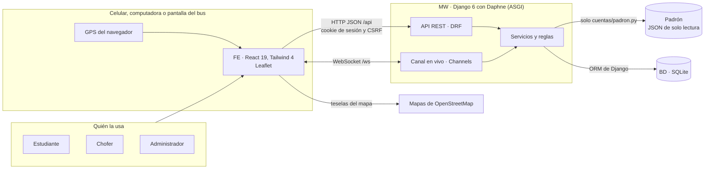
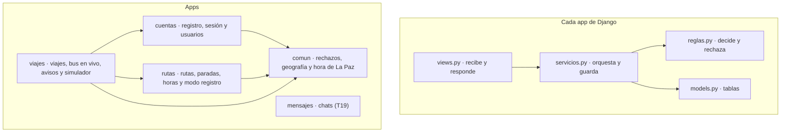
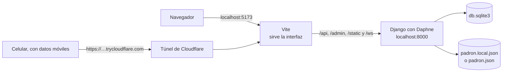
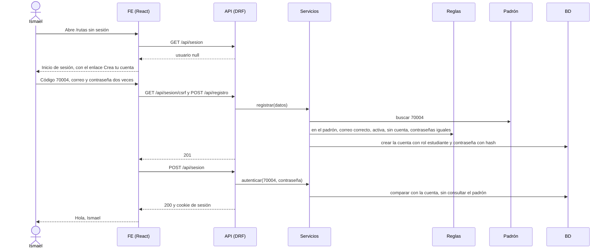

# Sesión 12 — Arquitectura

- Proyecto: UPBus — Buses UPB en tiempo real (UPB Santa Cruz)
- Integrantes: Hugo Zuñiga (Product Owner), Andrés Laura Vargas (Scrum Master) y Sebastian Cruz
- Fecha: 26/11/2026 · Sprint 2 · Tarea T03 del [plan](sesion-08-09-plan.md) · Issue: [#3](https://github.com/hugozuniga770/UPBus/issues/3)
- Estado: aprobado por el Product Owner el 26/11/2026 (T03). Andrés Laura Vargas, responsable de T03, puede proponer cambios con un Pull Request (C-36).
- Requisitos: [Sesión 6](sesion-06-requisitos.md) (restricciones BUS-RT y calidad BUS-RC) · Diseño de datos y clases: [Sesiones 13–14](sesion-13-14-diseno.md) · Secuencias: [diagramas-secuencia.md](diagramas-secuencia.md) · Siglas: [glosario.md](glosario.md)

## 0. Cómo leer este documento

- Aquí está la **arquitectura**: qué piezas tiene UPBus, cómo se hablan, dónde corren y por qué se eligieron así. El detalle de cada modelo, función y ruta de la API está en la sesión 13–14; el paso a paso de cada caso de uso, en los diagramas de secuencia.
- La sección 7 es la **verificación de punta a punta**: el registro y el inicio de sesión probados con la app real, del navegador a la base de datos.
- Todo lo que se describe ya está construido en `develop`, salvo el hosting (sección 4.2), que se prepara en T22.

## 1. Vista general: FE / MW / Padrón / BD

UPBus es una **aplicación web de una sola página** que habla con un **servidor Django** por HTTP y por WebSocket. El servidor es el único que toca el padrón y la base de datos.

| Pieza | Qué hace | Tecnología | Dónde está | Restricción |
|---|---|---|---|---|
| FE | Pantallas por rol: mapa con el bus en vivo, «Voy a subir», modo registro, usuarios, panel de demo. Lee el GPS del celular cuando hace falta | React 19, Vite, Tailwind 4, Leaflet con OpenStreetMap | `frontend/src/` | RT-03, RT-06 |
| API REST | Recibe cada pedido, valida su formato y responde JSON; todo rechazo sale como `{"causa": ...}` | Django REST Framework | `*/views.py`, `*/urls.py`, `*/serializadores.py` | RT-01, RC-01 |
| Canal en vivo | Empuja la posición del bus a quienes miran el viaje y avisos privados al chofer | Django Channels, capa en memoria | `viajes/consumers.py`, `config/asgi.py` | RT-04 |
| Servicios y reglas | Los servicios orquestan y guardan en transacciones; las reglas deciden y rechazan con su causa, sin tocar la BD | Python | `*/servicios.py`, `*/reglas.py` | RC-03 |
| Padrón | Lista de personas de la UPB con su código, correo, rol y si está activa. Se lee, nunca se escribe | Archivo JSON | `padron/padron.json` (ejemplo) o `padron/padron.local.json` (la clase, fuera de Git) | RC-04, C-20 |
| BD | Cuentas, rutas, paradas, pasos, viajes, posiciones y avisos | SQLite en desarrollo; PostgreSQL en el hosting (T22, en preparación) | `*/models.py`, `*/migrations/` | RT-02 |

## 2. Cómo se hablan las piezas

| De → a | Cómo | Quién puede | Ejemplo |
|---|---|---|---|
| FE → API | HTTP con JSON bajo `/api/`. La sesión va en la cookie de Django; toda escritura lleva el token CSRF en `X-CSRFToken` | Según el rol de la cuenta, que el servidor vuelve a comprobar en cada operación (RF-03) | `POST /api/registro`, `POST /api/viajes/<id>/posiciones` |
| API → FE en vivo | WebSocket en `ws/viajes/<id>/` (la posición del bus) y `ws/viajes/<id>/chofer/` (avisos y ubicaciones de los estudiantes) | El canal público solo valida que la conexión venga de la app: la posición del bus no es un dato personal. El privado exige la sesión del chofer de ese viaje o de un administrador; a cualquier otro lo cierra con el código 4403 | «Ismael va a subir en Sevilla» |
| Celular sin señal → API | Lo que manda el celular espera en una cola y se reenvía con su `id_cliente`; el servidor reconoce el reenvío y no duplica | Quien graba o el chofer | Marcas del modo registro, posiciones del bus |
| Servicios → Padrón | Lectura del archivo, solo desde `cuentas/padron.py` | — | Registrar a una persona |
| Servicios → BD | ORM de Django, en transacciones: un rechazo no deja nada a medias | — | Crear la cuenta, cerrar un aviso |
| FE → OpenStreetMap | Teselas del mapa, directo desde el navegador | — | El fondo del mapa |

Los mensajes por WebSocket se mandan con `transaction.on_commit`: solo salen cuando lo guardado ya está en la BD.

## 3. Capas y módulos del servidor

- **Las vistas no tocan la BD ni llaman a las reglas; las reglas no tocan la BD** (AGENTS.md). Así cada regla se prueba sola y cada criterio de la sesión 7 tiene su test.
- `comun` no depende de ninguna app. `viajes` usa `rutas` (paradas, pasos y horas aproximadas) y `cuentas` (quién es chofer o estudiante).
- Comandos de mantenimiento: `importar_padron` arma el padrón de la clase, `cargar_rutas` carga las rutas y sus horarios, e `importar_registro` y `simular` llaman a los mismos servicios que la app (modo registro y viajes).

## 4. Dónde corre

### 4.1 En desarrollo (hoy)

Vite le pasa a Django todo lo que no es la interfaz, así la interfaz y el servidor comparten el mismo origen: la cookie de sesión y el CSRF funcionan sin configuración extra. El celular solo entrega el GPS a una página con HTTPS; por eso, mientras no hay hosting, se usa un túnel gratuito ([guía del modo registro](guia-modo-registro.md)).

### 4.2 En el hosting (T22, en preparación)

La propuesta de T22 ([issue #17](https://github.com/hugozuniga770/UPBus/issues/17)) es un solo contenedor en Render con el plan gratuito (RT-08): la interfaz compilada, la API y el WebSocket servidos por **un único proceso de Daphne**, con PostgreSQL gratuito para que los datos no se pierdan cuando el contenedor se reemplaza, y el padrón de la clase como archivo secreto, fuera de Git. Con HTTPS propio, el modo registro ya no necesita el túnel. Un solo proceso es la condición para seguir con la capa de Channels en memoria (sección 5).

## 5. Decisiones y alternativas

| Decisión | Alternativa que se dejó | Por qué |
|---|---|---|
| Aplicación web, primero para el celular (PO13) | App nativa | Se abre desde cualquier celular o desde la pantalla del bus (ENT-01) sin instalar nada. El costo: el GPS del chofer exige la página abierta y la pantalla encendida (limitación declarada en la sesión 6) |
| Monolito Django con apps separadas | Microservicios | Tres personas, un sprint por semana y un solo despliegue gratuito: un monolito ordenado por apps y capas alcanza y se prueba entero con `pytest` |
| Cookie de sesión de Django con CSRF (RT-05) | Tokens en el navegador | La interfaz y el servidor comparten origen gracias al proxy de Vite; no hay tokens que guardar en el navegador |
| Canal de Channels en memoria | Redis | Basta con un solo proceso, que es lo que usa el MVP. Si se escala a más de uno, la capa se cambia por Redis sin tocar los servicios |
| Padrón como archivo de solo lectura, leído desde un solo módulo | Leerlo desde cada vista | Lo simulado queda aislado (RC-04): cambiarlo por el sistema real de la UPB toca solo `cuentas/padron.py`. Según ENT-07, el padrón real se pediría a Sistemas por la jefatura de carrera |
| `id_cliente` en todo lo que manda el celular | Confiar en que la señal no se corta | ENT-01 y ENT-02 contaron que la ubicación se corta; con el identificador, un reenvío no duplica nada |
| Distancia de llegada configurable (C-34) | Fijarla en el código | Se calibra con los viajes de prueba cambiando `UPBUS_RADIO_DE_LLEGADA_M`, sin tocar el código |
| Viajes simulados marcados (C-28) | Simular sobre viajes reales | El simulador usa los mismos servicios que la app, pero sus pasos no cambian las horas aproximadas |

## 6. Cómo la arquitectura cumple la calidad pedida

| Requisito | Cómo se cumple |
|---|---|
| RC-01 El rechazo muestra la causa | Las reglas lanzan `Rechazo("causa")` y un manejador común lo convierte en `{"causa": ...}` con 400, 403 o 404 |
| RC-02 Una consulta no modifica datos | Las vistas de lectura solo llaman a servicios de lectura |
| RC-03 Sin operaciones a medias | Los servicios que escriben usan transacciones, y los mensajes en vivo salen con `on_commit` |
| RC-04 Lo simulado está identificado | Padrón aislado en un módulo; viajes simulados con su marca; recargas y retiros simulados declarados en la sesión 6 |
| RC-05 Interfaz cuidada en celular y computadora | Una sola interfaz responsiva; el mapa ocupa la pantalla del celular y las tarjetas suben desde abajo |
| Privacidad | La lista de la clase no entra al repositorio público (C-20). La ubicación de un estudiante solo la ve el chofer de su viaje (y un administrador), se guarda solo la última y se borra al cancelar, al cerrarse el aviso o al terminar el viaje; con T16, también al subir. La UPB la considera información sensible (ENT-07), así que no se guarda un historial |

## 7. Verificación de punta a punta: registro e inicio de sesión

**Qué se probó:** el recorrido completo de una persona del padrón, del navegador a la base de datos, con la app real: Django 6.1.3 con Daphne 4.2.3, DRF 3.18.3, Channels 4.3.2, React 19 con Vite 8. El navegador fue Chromium, manejado con Playwright para que la prueba se pueda repetir. Base nueva y padrón de ejemplo (`padron/padron.json`). Fecha: 26/11/2026.

| # | Paso | Esperado | Lo que pasó | Llamadas a la API |
|---|---|---|---|---|
| 1 | Sin sesión, abre `/rutas` | Lo lleva al inicio de sesión, con el enlace «Crea tu cuenta» (RF-01) | `/ingresar`, con el enlace visible ✅ | `GET /api/sesion` 200 |
| 2 | Ismael (70004, `ismael@upb.example`) se registra | Cuenta creada y sesión abierta (HU01-CA1) | Inicio con «Hola, Ismael» ✅ | `GET /api/sesion/csrf` 200 · `POST /api/registro` 201 · `POST /api/sesion` 200 |
| 3 | Cierra sesión | Vuelve al inicio de sesión (HU02-CA4) | `/ingresar` ✅ | `DELETE /api/sesion` 204 |
| 4 | Entra con su código | Entra (HU02-CA1) | «Hola, Ismael» ✅ | `POST /api/sesion` 200 |
| 5 | Entra con su correo | Entra (HU02-CA2) | «Hola, Ismael» ✅ | `POST /api/sesion` 200 |
| 6 | Contraseña incorrecta | «Código, correo o contraseña incorrectos» (HU02-CA3) | El mismo mensaje ✅ | `POST /api/sesion` 400 |
| 7 | Lucía (70005, inactiva) intenta registrarse | «persona no activa en el padrón» (HU01-CA3) | El mismo mensaje ✅ | `POST /api/registro` 400 |
| 8 | Ismael intenta registrarse otra vez | «ya tienes una cuenta» (RF-01, rechazo 4) | El mismo mensaje ✅ | `POST /api/registro` 400 |

Al terminar, la base tenía **una sola cuenta** (70004, estudiante), con la contraseña guardada como hash `pbkdf2_sha256`, y el archivo del padrón seguía **idéntico** (misma suma SHA-256 antes y después): el registro lee el padrón y nunca lo escribe (RF-01).

**Lo mismo, en la integración continua:** cada Pull Request corre los criterios HU01-CA1 a CA4 y HU02-CA1 a CA4 en pytest, y HU01-CA3 y HU02-CA3 en Vitest ([trazabilidad](trazabilidad.md)).

**El tiempo real, también de punta a punta:** el 26/11/2026, con el servidor andando, una simulación del panel Demo sobre la Ruta Sur (T23) hizo llegar 42 posiciones del bus en 6 segundos a un navegador conectado a `ws/viajes/<id>/`. Recorrió el camino completo: servicios → BD → Channels → navegador ([guía del simulador](guia-simulador.md)).

## 8. Participación y asistencia utilizada

- **Hugo Zuñiga:** redactó este documento y la verificación de la sección 7 el 26/11/2026 (C-36).
- **Andrés Laura Vargas:** responsable de T03; su revisión de este documento queda pendiente.
- **Asistencia de IA:** se usó Claude (Anthropic) para redactar el documento a partir del código, la sesión 13–14 y los requisitos, y para automatizar con Playwright la verificación de la sección 7.
