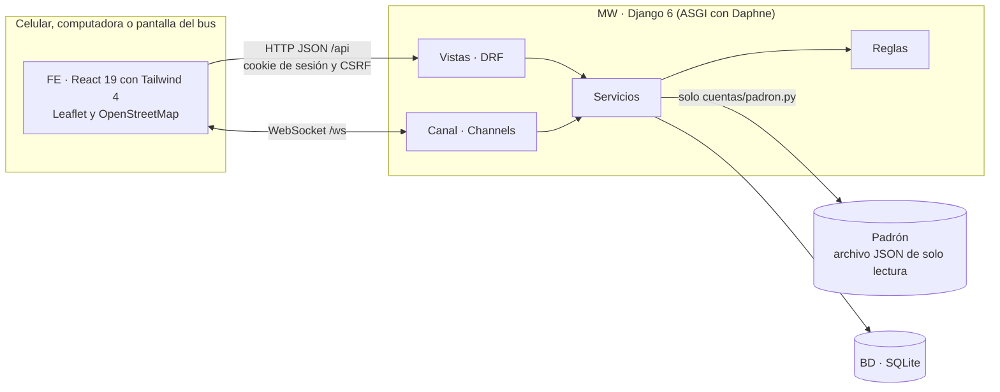
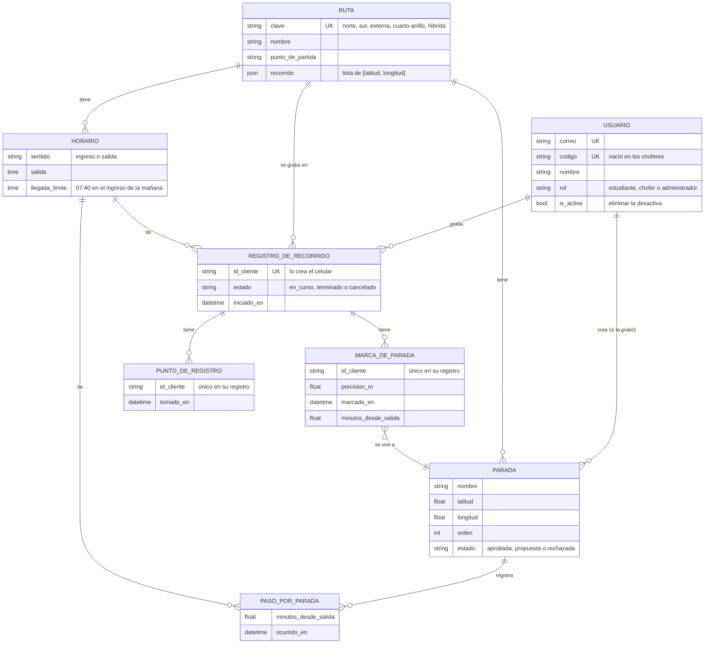
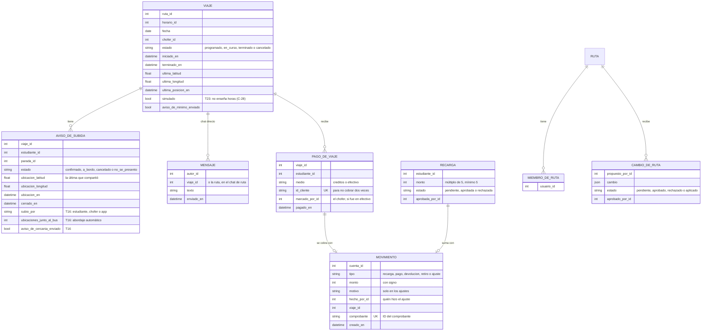

# Sesiones 13 y 14 — Diseño: arquitectura, datos y clases

- Proyecto: UPBus — Buses UPB en tiempo real (UPB Santa Cruz)
- Integrantes: Hugo Zuñiga (Product Owner), Andrés Laura Vargas (Scrum Master) y Sebastian Cruz
- Fecha: 18/11/2026 · Actualizado: 26/11/2026 (`AvisoDeSubida` de T14, `Viaje.simulado` de T23 y, en la sección 3, C-28 a C-32; antes, C-23 y C-25) · Sprint 1 · Tarea T03 · Issue: [#3](https://github.com/hugozuniga770/UPBus/issues/3)
- Estado: la sección 2 y las secciones 4 a 6 describen el **código ya construido**. En la sección 3, `Viaje`, `PosicionDeViaje` y `AvisoDeSubida` ya están implementados; los demás modelos y los campos marcados para T16 son **[PROPUESTA]** para las historias que faltan.
- Requisitos: [Sesión 6](sesion-06-requisitos.md) · Historias: [Sesión 7](sesion-07-modelos.md) · Secuencias: [diagramas-secuencia.md](diagramas-secuencia.md) · Trazabilidad: [trazabilidad.md](trazabilidad.md)

## 0. Cómo leer este documento

- **FE** es la interfaz (React), **MW** el servidor Django que aplica las reglas, **Padrón** la lista de la universidad y **BD** la base de datos (SQLite).
- Quien toma una historia lee la sección 3 para su modelo y la sección 4 para el molde de sus capas. Si cambia algo de lo propuesto, lo corrige aquí y, si era algo acordado, lo anota en [cambios.md](cambios.md).

## 1. Arquitectura FE / MW / Padrón / BD

| Capa | Qué es | Dónde está |
|---|---|---|
| FE | Las pantallas. Primero el celular: mapa a pantalla completa y tarjetas que suben desde abajo | `frontend/src/` |
| Vistas | Reciben, leen el formato con un serializador, llaman a un servicio y responden JSON | `views.py`, `serializadores.py` |
| Servicios | Orquestan: leen, preguntan a las reglas y guardan, en una transacción | `servicios.py` |
| Reglas | Deciden y rechazan con su causa. No tocan la BD | `reglas.py` |
| Canal | Empuja al instante la ubicación del bus, los avisos y los mensajes | `consumers.py`, `routing.py` |
| Padrón | Lista de personas de la UPB. Solo se lee, y solo desde un módulo | `padron/`, `cuentas/padron.py` |
| BD | Las tablas | `models.py` y `migrations/` |

**En desarrollo**, Vite (puerto 5173) le pasa `/api`, `/admin`, `/static` y `/ws` a Django (puerto 8000), así FE y MW comparten el mismo origen. Para el celular, un túnel HTTPS gratuito apunta a Vite ([guía del modo registro](guia-modo-registro.md)).

## 2. Datos que ya existen

| Modelo | App | Para qué | Restricciones |
|---|---|---|---|
| `Usuario` | cuentas | La cuenta: entra con código o correo (`CodigoOCorreoBackend`) | `correo` y `codigo` únicos. El rol sale del padrón; los choferes los crea un administrador |
| `Ruta` | rutas | Las 5 rutas de la guía, cargadas con `cargar_rutas` | `clave` única |
| `Horario` | rutas | Cada salida de una ruta, de ingreso o de salida | Única por ruta, sentido y hora de salida |
| `Parada` | rutas | Una parada de una ruta, con su estado | Solo las aprobadas las ven todos; el chofer y el administrador ven también las propuestas |
| `RegistroDeRecorrido` | rutas | Una grabación del modo registro | `id_cliente` único: un reenvío del inicio no crea otro |
| `MarcaDeParada` | rutas | Cada «Parada aquí» | Única por registro e `id_cliente` |
| `PuntoDeRegistro` | rutas | El recorrido grabado | Único por registro e `id_cliente` |
| `PasoPorParada` | rutas | Cada vez que el bus pasó por una parada, con los minutos desde la salida | Lo usan el modo registro y, cuando exista, el viaje en vivo (`registrar_paso`) |

## 3. Datos propuestos para las historias que faltan **[PROPUESTA]**

| Modelo | App | Historia | Notas |
|---|---|---|---|
| `Viaje` y `PosicionDeViaje` | viajes | HU-05, HU-06 | Implementados. `Viaje` guarda la última posición; `PosicionDeViaje.id_cliente` evita duplicar reenvíos. Un chofer tiene un solo viaje en curso. `Viaje.simulado` marca los viajes del simulador (T23), que no enseñan horas (C-28) |
| `AvisoDeSubida` | viajes | HU-07, HU-09, HU-10 | Implementado. Un aviso activo por estudiante y viaje (HU07-CA2). Cuando el bus llega a otra parada, los confirmados en las que ya pasó quedan «no se presentó»; al terminar el viaje, todos los confirmados (P-33). La ubicación del estudiante va en el mismo aviso (`ubicacion_latitud`, `ubicacion_longitud`, `ubicacion_en`): solo la última, y se borra al cancelar, al cerrarse o al terminar el viaje; con T16, también al subir. Con esa ubicación, T16 detecta que subió: el bus a más de 100 m de su parada y dos ubicaciones seguidas a menos de 50 m del bus (P-33). El abordaje es su estado A bordo, con quién lo marcó: el estudiante, el chofer o la app (C-30); subir no cobra (C-31) |
| `PagoDeViaje` | `creditos` (app nueva) o viajes | HU-12 | Uno por estudiante y viaje. Con créditos genera el cobro, el abono al chofer y el comprobante; en efectivo lo marca el chofer, sin movimiento. `id_cliente` único para que un reenvío no cobre dos veces (HU12-CA3) |
| `Recarga` y `Movimiento` | `creditos` (app nueva) o viajes | HU-11 a HU-13 | El saldo es la suma de los movimientos; nunca se guarda aparte. Cada cobro, devolución, retiro o ajuste es un movimiento completo o ninguno (RC-03). El ajuste del administrador lleva su motivo y quién lo hizo, y no deja el saldo en negativo (C-29) |
| `Mensaje` y `MiembroDeRuta` | mensajes | HU-14, HU-15 | Solo texto (P-10) |
| `CambioDeRuta` | rutas | HU-16 | Todo cambio del chofer queda pendiente hasta que un administrador lo aprueba; los del administrador se aplican directamente (C-32) |

## 4. Clases y funciones por capa (lo que hay)

| App | Reglas | Servicios | Vistas |
|---|---|---|---|
| `comun` | `Rechazo` (400), `SinPermiso` (403), `NoExiste` (404); `distancia_en_metros`, `coordenadas_validas`; `ahora`, `a_hora_local` | `leer` (valida un serializador) | `manejar_excepcion` y `falla_csrf`: todo rechazo sale como `{"causa": ...}` |
| `cuentas` | `verificar_persona_en_padron`, `verificar_correo_del_padron`, `verificar_persona_activa`, `verificar_sin_cuenta`, `verificar_contrasenas_iguales`, `verificar_contrasena`, `rol_desde_el_padron`, `verificar_credenciales`, `verificar_es_administrador`, `verificar_rol_valido`, `verificar_correo_libre`, `verificar_codigo_libre`, `verificar_no_es_uno_mismo` | `registrar`, `autenticar`, `listar_cuentas`, `crear_cuenta`, `buscar_cuenta`, `eliminar_cuenta` | `CsrfVista`, `RegistroVista`, `SesionVista`, `UsuariosVista`, `UsuarioVista` |
| `rutas` | `verificar_puede_registrar`, `verificar_horario_de_la_ruta`, `verificar_sin_registro_en_curso`, `verificar_es_su_registro`, `verificar_registro_en_curso`, `verificar_coordenadas`, `verificar_lejos_de_las_otras_marcas`, `verificar_hay_marcas`, `estado_de_una_parada_nueva`, `radio_de_llegada`, `llego_a_la_parada`, `parada_mas_cercana`, `minutos_entre`, `salida_programada`, `promedio_de_los_ultimos`, `hora_aproximada`, `llegada_limite` | `listar_rutas`, `ver_ruta`, `paradas_visibles`, `horas_aproximadas`, `registrar_paso`, `reordenar_paradas`, `iniciar_registro`, `marcar_parada`, `agregar_puntos`, `terminar_registro`, `cancelar_registro`, `importar_registro` | `RutasVista`, `RutaVista`, `RegistrosVista`, `RegistroEnCursoVista`, `MarcasVista`, `PuntosVista`, `TerminarRegistroVista`, `CancelarRegistroVista` |
| `viajes` | `verificar_es_su_viaje`, `verificar_programado`, `verificar_sin_viaje_en_curso`, `verificar_en_curso`, `verificar_coordenadas`, `verificar_puede_avisar`, `verificar_viaje_abierto`, `verificar_parada_de_la_ruta`, `verificar_bus_no_paso`, `verificar_sin_aviso_activo`, `verificar_es_su_aviso`, `verificar_aviso_confirmado`, `verificar_puede_ver_avisos`; del simulador: `verificar_escenario`, `verificar_velocidad`, `verificar_recorrido`, `verificar_hay_paradas`, `verificar_sin_simulacion_en_curso` | `listar_viajes`, `buscar_viaje`, `iniciar_viaje`, `terminar_viaje`, `registrar_posicion`, `avisar_que_va_a_subir`, `cancelar_aviso`, `compartir_ubicacion`, `avisos_del_viaje`, `aviso_activo_de`, `dejar_de_compartir`, `cerrar_no_presentados`, `cerrar_avisos_del_viaje`. En `simulador.py` (T23): `trayecto`, `correr`, `panel`, `iniciar_simulacion`, `detener_simulacion` | Vistas de viajes y posiciones; `ViajeConsumer` entrega posiciones al grupo `viaje_<id>`; `ChoferDelViajeConsumer`, canal privado del chofer; `SimulacionesVista` y `DetenerSimulacionVista`, panel de demo |
| `mensajes` | Por hacer (T19) | Por hacer | Por hacer |

Comandos: `importar_padron` (cuentas), `cargar_rutas` e `importar_registro` (rutas), `simular` (viajes, T23).

## 5. API

Todas las rutas empiezan con `/api/` y responden JSON. Toda escritura lleva el token CSRF en la cabecera `X-CSRFToken`.

| Método y ruta | Quién | Qué hace | Historia |
|---|---|---|---|
| `GET sesion/csrf` | Cualquiera | Entrega la cookie CSRF | HU-01, HU-02 |
| `POST registro` | Persona del padrón | Crea la cuenta y deja la sesión abierta | HU-01 |
| `GET sesion` | Cualquiera | Quién está dentro (`usuario` o `null`) | HU-02 |
| `POST sesion` | Cualquiera | Entra con código o correo y contraseña | HU-02 |
| `DELETE sesion` | Con sesión | Cierra la sesión | HU-02 |
| `GET usuarios` · `POST usuarios` | Administrador | Lista las cuentas · crea una | HU-03 |
| `DELETE usuarios/<id>` | Administrador | Desactiva la cuenta | HU-03 |
| `GET rutas` | Con sesión | Las rutas con sus horarios | HU-04 |
| `GET rutas/<id>?horario=<id>` | Con sesión | La ruta con recorrido, paradas y hora aproximada | HU-04 |
| `GET viajes?ruta=<id>&estado=en_curso` | Con sesión | Lista los viajes visibles; para estudiantes, solo los que están en curso | HU-05, HU-06 |
| `GET viajes/<id>` | Con sesión | Detalle y última posición conocida del viaje | HU-06 |
| `POST viajes/<id>/iniciar` · `POST viajes/<id>/terminar` | Chofer asignado | Cambia el estado y guarda la hora de inicio o fin | HU-05 |
| `POST viajes/<id>/posiciones` | Chofer asignado | Guarda una posición única, registra pasos cercanos y la publica por WebSocket | HU-06 |
| `POST viajes/<id>/avisos` · `GET viajes/<id>/avisos` | Estudiante o administrador · chofer del viaje o administrador | Avisa «Voy a subir» · lista quién va a subir, con su ubicación | HU-07 |
| `GET viajes/<id>/mi-aviso` | Con sesión | El aviso activo de quien pregunta, si tiene | HU-07 |
| `POST avisos/<id>/cancelar` · `POST avisos/<id>/ubicacion` | El estudiante del aviso | Cancela mientras el bus no pasó · comparte su ubicación | HU-07 |
| `POST registros` | Chofer o administrador | Inicia un registro | HU-18 |
| `GET registros/en-curso` | Chofer o administrador | El registro sin terminar, si hay | HU-18 |
| `POST registros/<id>/marcas` | Quien graba | Guarda una marca; un reenvío no duplica | HU-18 |
| `POST registros/<id>/puntos` | Quien graba | Guarda puntos del recorrido | HU-18 |
| `POST registros/<id>/terminar` | Quien graba | Crea o une paradas y recalcula horas | HU-18 |
| `POST registros/<id>/cancelar` | Quien graba | Cancela sin crear nada | HU-18 |
| `ws/viajes/<id>/` (WebSocket) | Cualquiera desde la app (solo se valida el origen; la posición del bus no es un dato personal) | Canal que confirma la conexión y entrega la posición del bus | HU-06 |
| `ws/viajes/<id>/chofer/` (WebSocket) | Chofer del viaje o administrador | Canal privado: «Ismael va a subir en Sevilla», avisos cerrados y ubicaciones | HU-07 |
| `GET simulaciones` · `POST simulaciones` | Administrador | Escenarios y simulaciones corridas · inicia una (202); una a la vez | T23 |
| `POST simulaciones/<id>/detener` | Administrador | Detiene la simulación y termina su viaje | T23 |

## 6. Interfaz

| Ruta | Pantalla | Quién | Historia |
|---|---|---|---|
| `/ingresar` | Iniciar sesión con código o correo | Cualquiera | HU-02 |
| `/registrarse` | Crear la cuenta con el padrón | Persona del padrón | HU-01 |
| `/` | Inicio con tarjetas según el rol; las que faltan dicen «Próximamente» con su historia | Con sesión | — |
| `/rutas` | Mapa con recorrido, paradas, horas aproximadas y el bus del viaje en curso; «Voy a subir», cancelar y compartir la ubicación | Con sesión | HU-04, HU-06, HU-07 |
| `/viajes` | Iniciar o terminar el viaje asignado, compartir el GPS del bus y ver quién va a subir | Chofer | HU-05, HU-06, HU-07 |
| `/modo-registro` | Grabar paradas y horas con el GPS | Chofer o administrador | HU-18 |
| `/usuarios` | Crear choferes y personas, y desactivar cuentas | Administrador | HU-03 |
| `/demo` | Panel de demo: correr y detener escenarios del simulador | Administrador | T23 |

Piezas compartidas: `api/cliente.js` (todas las llamadas, el token CSRF y `ErrorApi` con la causa), `sesion/` (quién está dentro y las rutas protegidas por rol), `componentes/` (Boton, Campo, Aviso, Mapa, Plantilla, PantallaDeAcceso, Logo) y `registro/` (la cola sin señal, el almacenamiento en el celular y el respaldo).

## 7. Decisiones de diseño y su porqué

| Decisión | Por qué |
|---|---|
| Cookie de sesión de Django con CSRF, y no tokens (RT-05) | La interfaz y el servidor comparten origen gracias al proxy de Vite; no hay tokens que guardar en el navegador |
| El padrón se lee solo desde `cuentas/padron.py` | Lo simulado queda aislado (RC-04): cambiar al sistema real de la UPB toca un solo módulo |
| Eliminar una cuenta la desactiva (P-23) | Para no perder viajes ni comprobantes |
| Cada paso guarda los minutos desde la salida programada del horario | Así se promedian viajes distintos y también se aprende si el bus suele salir tarde: con el primer viaje real, contar desde la primera marca adelantaba las horas 6 minutos (C-23) |
| Promedio de los últimos 5 pasos (P-11), redondeado hacia abajo | Reacciona a cambios recientes sin depender de un solo viaje; hacia abajo para que nadie llegue segundos tarde (C-23) |
| Todo lo que manda el celular lleva un `id_cliente` | Sin señal, el celular reintenta; el servidor reconoce el reenvío y no duplica (HU18-CA5) |
| Canal de Channels en memoria | Basta con un solo proceso en el MVP. Si el hosting usa más de uno, se cambia a Redis **[PROPUESTA]** (T22) |
| SQLite (RT-02) | Gratis y sin servidor aparte; suficiente para el MVP |
| Subir y pagar son dos pasos distintos (C-31) | Así se paga hoy: el chofer revisa los comprobantes al final. Además, el abordaje automático no podría cobrar sin que el estudiante lo pida |
| Los viajes del simulador no guardan pasos (C-28) | Las horas que ve el estudiante salen solo de viajes reales |
| Distancia de llegada configurable (`UPBUS_RADIO_DE_LLEGADA_M`, C-34) | Empieza en 50 m y se calibra con los viajes de prueba sin cambiar el código; la leen las reglas con `radio_de_llegada()` |

## 8. Participación y asistencia utilizada

- **Hugo Zuñiga:** decidió la tecnología (PO13) y aprueba este diseño.
- **Sebastian Cruz:** implementó el diseño de viajes y bus en vivo de T11 (HU-05 y HU-06); mantiene pendiente la revisión de T03.
- **Asistencia de IA:** se usó Claude (Anthropic) para construir la base, describir su diseño y proponer los modelos de la sección 3; el 25/11/2026, para ajustarlos a las decisiones del Product Owner (PO25). Sebastian usó OpenAI Codex para implementar y verificar T11 siguiendo la skill `implementar-historia`.
- **Hugo Zuñiga (25/11/2026):** implementó `AvisoDeSubida`, el canal privado del chofer y las rutas de HU-07 (T14), con asistencia de Claude (Anthropic).
